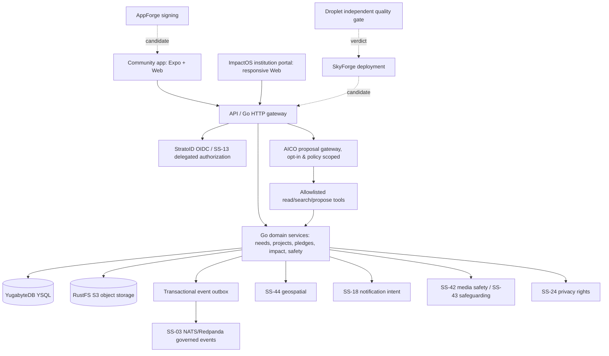

# Architecture, Boundaries and Proposed API Contracts

## C4-level component picture

**ASCII fallback:** Expo/Web → Go API → YSQL + RustFS + transactional outbox; integrations with StratoID and Shared Services; AICO only through policy-scoped proposal gateway; AppForge/SkyForge/Droplet outside runtime.

## Services and authoritative ownership
| Bounded context | Existing/reuse | Proposed additive domain | Who may authorize writes |
|---|---|---|---|
| Needs | `services/api/internal/needs` | triage hints, review assignment | reporter for observations; verifier for states |
| Evidence | `internal/evidence` | provenance evaluation, redactions, attestations | authorized evidence reviewer, safety ops |
| Action Projects | `internal/projects` | programmes, tasks, milestones, planned outcomes | project resource ACL + institution membership |
| Contributions | offers/commitments in `internal/projects` | skill profiles, match proposals, availability | contributor opt-in; coordinator accepts with policy |
| Impact | `internal/impact/passport.go` | baselines, outputs, outcomes, maintenance and appeal | independent reviewer per outcome policy |
| Trust/safety | `internal/safety`, `internal/auth` | risk queue, synthetic media triage, safeguarding | delegated human trust reviewers |
| Privacy | `internal/privacy` | opt-in preferences, redaction and retention | data subject / lawful service roles |
| Finance | `internal/funding` | pledge reporting only | current safeguarded pledge policy; NO payments |
| AI | external AICO system (must discover) | proposal/feedback/evaluation bridge | delegated read/propose; human confirmation |

**First action:** extract actual authorization, event types and schema from existing Go services and migrations. These tables are proposed additions, not assertions that new code already exists.

## Source tree and migration plan
- Existing migrations `services/api/migrations/0001_core.sql` through `0010_platform_safety_subject.sql` on main. Reserve **0011+** for additive ordered, idempotent changes, after checking whether another branch already claimed them. Avoid overlapping migration numbers; use separate PR boundaries and an ADR.
- Use YSQL-compatible SQL and standard `pgx` path; do not install a parallel PostgreSQL or PostGIS authority.
- New data must carry stable UUID or existing canonical ID conventions; `tenant_id`/`institution_id` or explicit scoped identity; timestamp, actor, audit/version, privacy and retention metadata; logical deletion where data rights demand it.
- All user-to-org or volunteer-to-project joins must be scoped by tenant and resource permission. Test negative cross-tenant queries and event consumption. Consider YugabyteDB query indexing and global scale only after profiling.
- Atomic domain writes + outbox insertion in one transaction; consumer idempotency keys and replay defense; dead-letter and gap detection.
- Do not change response semantics for 51 registered OpenAPI method/path operations without versioned migration and compatibility tests.

## Proposed new resource contracts (draft; refine against existing OpenAPI)

### Institutions & programmes
| Method | Route candidate | Purpose | Security rule |
|---|---|---|---|
| POST | `/v1/institutions` | Create or request verified organization | authenticated, independent approval where required |
| GET | `/v1/institutions/{id}` | Institution summary | public safe projection or tenant membership |
| POST | `/v1/institutions/{id}/programmes` | Create scoped programme | explicit org role + policy decision |
| GET | `/v1/institutions/{id}/programmes` | List tenant-scoped programmes | tenant-scoped projection |
| POST | `/v1/programmes/{id}/tasks` | Create volunteer opportunity | project coordinator, review flags |
| POST | `/v1/programmes/{id}/members/invitations` | Invite by consent | manage_members permission; abuse rate limits |
| GET | `/v1/programmes/{id}/report` | Generate human-readable evidence report | report scope, redaction, reviewer state |

### Ability profile / matching
| Method | Route candidate | Purpose | Security rule |
|---|---|---|---|
| GET/PUT | `/v1/me/ability-profile` | Consent and abilities | subject owner only, minimal public projection |
| POST | `/v1/opportunities/{id}/matches/evaluate` | Deterministic eligible options | coordinator or participant; consent scoped |
| GET | `/v1/me/match-recommendations` | Private personalized recommendations | user-owned and consent gating |
| POST | `/v1/opportunities/{id}/applications` | Volunteer intent | user request, idempotency key |
| POST | `/v1/applications/{id}/decision` | Offer/accept/decline | delegated coordinator; reason, audit |
| POST | `/v1/applications/{id}/fulfilment` | Record completion and evidence | distinct reviewer/fulfiller authority |

### Evidence integrity / outcomes
| Method | Route candidate | Purpose | Security rule |
|---|---|---|---|
| GET | `/v1/evidence/{id}/provenance` | Moderation-safe evidence provenance | explicit reviewer/approved public projection |
| POST | `/v1/evidence/{id}/review` | Human review + source trace | reviewer separation, safe state transitions |
| POST | `/v1/projects/{id}/outcomes` | Propose measured outcome | project owner, cannot self-publish |
| POST | `/v1/outcomes/{id}/attestations` | Reviewed outcome attestation | authorized independent reviewer |
| POST | `/v1/outcomes/{id}/challenges` | Community appeal | authentic subject and rate limits |
| POST | `/v1/outcomes/{id}/maintenance-reviews` | Follow-up durability assessment | maintenance owner + review policy |
| GET | `/v1/projects/{id}/impact-report` | Authorized report | versioned, redacted, provenance disclosures |

### AICO assistant
| Method | Route candidate | Purpose | Security rule |
|---|---|---|---|
| POST | `/v1/ai/proposals` | Triage or task/match/impact proposal | per-user consent, tenant-scoped tool policy |
| GET | `/v1/ai/proposals/{id}` | Status and citations | request author / delegated coordinator |
| POST | `/v1/ai/proposals/{id}/decisions` | Human accept/reject/edit | separate human, result auditable |
| POST | `/v1/ai/proposals/{id}/feedback` | Calibration and measured correctness | opt-in, no sensitive leakage |

These are **not committed endpoints** and should not be added wholesale. PR owners must inspect actual route handlers, name conflicts, OpenAPI conventions, pagination, auth headers and error shape; then author ADR and compatible schema before development.

## Cross-cutting API contract invariants
1. Authentication: existing StratoID/OIDC JWT validation, tenant context and `SS-13` authorization decisions must be enforced server-side. Reject unknown/expired/forged identities; denial must be auditable.
2. Error envelope: re-use current canonical errors (401,403,404,409,422,429,503); avoid leaking a resource's existence to unauthorized actors.
3. Idempotency: apply `Idempotency-Key` for state-changing creation, with TTL/replay semantics; retried offline submissions must not duplicate reports, payments or contributions.
4. Data minimization: geolocation is coarse or withheld by policy for public queries; sensitive attributes are not sent to models.
5. Pagination/sorting and rate limits; don't fetch whole tenant tables.
6. Date/time: timestamp UTC; local time localized in clients; consistency on expiry/appeal windows.
7. Event payloads: no raw personal contact details, public exact coordinates or secrets in outbox events.
8. Migration compatibility: old Expo releases may coexist while new API deploys; additive endpoints and fields first, staged enforcement later.
9. Feature flags: `impact_intelligence_v1`, `volunteer_matching_v1`, `aico_proposals_v1`, `institution_pilot_v1`, `provenance_c2pa_v1`. Default **off** until contract and approval.
10. Observability: structured audit vs operational logs separated; prevent PII in traces and metrics; bounded dimensions.

## Developer experience and frontend
- Keep the original FIELDWORK tokens, semantic contrast and transparent states. Build shared visual components rather than duplicating CSS/React Native designs with unrelated labels. Existing web `stitch-catalog.js` and Expo routes must still resolve.
- Keep mobile offline queue, location review and deferred retries. Provide states for `no available matches`, `no eligible contributor`, `pending reviewer`, `sensitive location hidden`, `model unavailable` and `measurement missing`.
- No “volunteer matched”, “verified outcome”, “donation received” or “95% impact” displays without corresponding real approved records.
- Accessible labels, focus order, keyboard interaction, VoiceOver/TalkBack, 44px+ controls, disabled states, low-bandwidth and language support including right-to-left when used.

## Architecture ADRs to author first
- ADR-001: Track A immutable certification vs Track B new release.
- ADR-002: Institution tenancy and scoped policy model.
- ADR-003: Write-once evidence bytes + optional credentials/provenance + review.
- ADR-004: Outcome semantics, measurement lifecycle and non-causality defaults.
- ADR-005: Opt-in ability profiles and matching transparency.
- ADR-006: AICO delegated proposal-only gateway and human approvals.
- ADR-007: Pledge-only finance boundary.
- ADR-008: MacBook runner isolation, public-fork threat model and GH required contexts.
- ADR-009: Data rights/deletion with immutable audit and backup/retention.
- ADR-010: Pilot launch jurisdiction, incident/abuse and escalations.

## External integrations: ownership and proof
- **Nvuto/Shared Services:** discover actual contracts/SDKs, then make a tenant-isolated adapter; unavailable or uncertified services must fail safely. No hidden local mock in production.
- **AICO:** discover canonical AI employee registry and orchestration contract; do not assert existing 30k+ AI employees can perform these tasks without skill validation. Attach evaluation and escalation traces.
- **GrowthOS:** opt-in partner onboarding/campaign integration only after approved programme and consent, no automated publicity about vulnerable people.
- **NexoCloud:** SkyForge runtime, AppForge mobile, Droplet release; neither is GA evidence absent independent run.
- **Institutional provider integrations:** import/export via auditable connectors with consent and rate-limit; defer CRM/HR sync until tenant agreements and data mapping exist.
