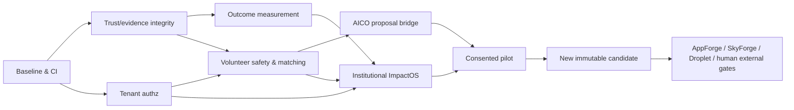

# iRespond 90-Day Autonomous Engineering and Evidence Plan
**Planning origin:** Day 1 = first Codex execution day, not an implied start on November 2 if execution occurs later.  
**Finish line:** New pilot-ready candidate with measured outcomes, opt-in matching, supervised AICO, institution programme MVP and real evidence; **not** blanket GA.

## Scheduling rules
- Workstreams overlap, but **production gates are sequential**. Build trust/measurement contracts before public AI action claims. Institution pilot requires tenant isolation before partner data.
- Preserve existing frozen source and historic run. Release new source only through PRs and new exact-SHA evidence.
- 90 days is a *planning horizon*, not a promise that external AppForge/SkyForge/Droplet, legal approvals or volunteers will be available. Make blockers visible and shift scope, never falsify evidence.
- Prefer 1–2 vertical slices per week, small reviewable PRs. Stop scope expansion after Day 60 except critical findings.

## Phase 0 — Days 1–14: correctness, security and baseline
| Week | Goal | Engineering work | Exit criteria |
|---|---|---|---|
| W1 / D1–7 | Baseline & blocked merge | Inventory existing local repo, PR #71, main/frozen candidate; secure Mac VM/runner feasibility; branch protection; threat model; `pnpm` audit #76; run core Go/Expo/Web/Helm tests; record hashes | Repeatable clean local test transcript, named external blockers, no uncommitted work overwritten |
| W2 / D8–14 | CI remediation and UI integration | Fix dependency configs/Metro compatibility, full app smoke, isolated runner required checks if scheduler permits, resolve PR conflicts, merge #71 only if real protections satisfied; photograph real clients; candidate ledger | PR merged **or** exact GitHub blocker reported; design regression gates and evidence files; `ga=false` |

**Freeze rule:** If CI cannot run due to nonpayment, do not merge by bypass. Begin additive engineering on separate branches not on main and keep candidate source distinct.

## Phase 1 — Days 15–35: trust and outcomes data authority
| Week | Goal | Engineering work | Exit criteria |
|---|---|---|---|
| W3 / D15–21 | Trust architecture & threat tests | ADR-003, risk categories, evidence origin/digest/privacy schema, SS-42/43 integration contract, reviewer separation, C2PA optional investigation | Reviewed threat model; negative tests for uploads/access/locations; C2PA not treated as truth |
| W4 / D22–28 | Measured impact persistence | ADR-004; YSQL migrations; output/outcome/baseline/method/durability records; OpenAPI; reviewer and community appeal states | Real DB integration tests; zero unauthorized cross-tenant access; zero fabricated output |
| W5 / D29–35 | Impact reporting vertical slice | Evidence moderation, outcome review and Passport output/outcome separation; versioned export, safe redaction; low-bandwidth UX | End-to-end: actual project output → reviewed measurement → safe report; uncertainty/missingness visible |

**Gate G1:** Source-evidence trust and measured-outcome semantics pass security/privacy reviews before AICO access to related data.

## Phase 2 — Days 36–56: volunteering and AICO proposals
| Week | Goal | Engineering work | Exit criteria |
|---|---|---|---|
| W6 / D36–42 | Ability profiles | Consent/availability/skills/capacity and safeguarding, project opportunity specification, migration, API, mobile/web profile editing | Self can edit/withdraw; coordinator sees only permissioned projection; offline behavior correct |
| W7 / D43–49 | Matching without AI | Deterministic eligibility, safe score explanations, apply/approve/decline/fulfil, capacity concurrency, audit and anti-spam | Full consented workflow with no duplicate commitments; no unauthorized placement |
| W8 / D50–56 | AICO safe proposals | Discover actual AICO registry, delegation ADR, tool allowlist, model router budgets, proposals-only triage/matching/summary, red-team fixtures | All forbidden agent side effects denied; missing service falls back; human approval enforced |

**Gate G2:** No AI agent affects roles, safety, evidence verification or people outside actual human authorization. If AICO not ready, matching remains deterministic and pilot continues.

## Phase 3 — Days 57–77: Institutional ImpactOS pilot
| Week | Goal | Engineering work | Exit criteria |
|---|---|---|---|
| W9 / D57–63 | Institution tenant model | ADR-002, institution and membership, programme scoped ACL, invites, segregated queries/events, cohort/tenant tests | No cross-tenant data; legitimate coordinators can manage own programmes |
| W10 / D64–70 | Coordinated programme MVP | Programme/task workflows, volunteer pipeline, review/appeals, accessible FIELDWORK dashboards, secure notification intents | Real pilot run can create programme, assign, fulfil and review one low-risk task |
| W11 / D71–77 | Real impact reporting | Privacy-safe reports, methodology, beneficiary feedback, maintenance follow-up, export checksums and audit | Institution report reviewed by owner; full lineage from approved project to outcome; affected community can dispute |

**Gate G3:** Consent, legal/privacy/safeguarding and institution pilot owner approve live test with actual participants; no high-risk emergency or minor/survivor pilot without independent controls.

## Phase 4 — Days 78–90: hardening, evidence and candidate decision
| Window | Goal | Work | Exit |
|---|---|---|---|
| D78–82 | Security/reliability closure | Adversarial audit, authz/tenant tests, RustFS/YSQL failure and backup drills, accessibility/low bandwidth, redaction and prompts | No untriaged P0/P1; source-level and integration tests green, rollback executable |
| D83–86 | Controlled pilot measurement | Measure actual attempts, accepted/fulfilled matches, evidence coverage, verified outcomes, feedback, cost/latency | Real denominators/time windows; missing data labeled unknown; reviewer signs report |
| D87–89 | Source candidate + handoff | Freeze new source SHA, run all required branch + main evidence when possible, AppForge/SkyForge/Droplet requests, store/privacy/legal packages | New exact candidate ledger; external evidence requests tracked; `ga=false` without approvals |
| D90 | Go/no-go council | Readiness report, risk register, human decision, backlog reprioritization | **PILOT GO** / **PILOT NO-GO** / **EXTERNAL GA NO-GO** independently declared |

## Definition of done: each PR, regardless of phase
- linked issue, precise problem, ADR, architecture/contract changes; relevant migration up/down or roll-forward strategy;
- named data owner, security policy and privacy classification;
- OpenAPI request/response examples and compat test; server-side authz and tenant negative tests;
- state machine integration + outbox/replay/idempotency where relevant;
- TypeScript Go frontend/backend validation; actual E2E with YugabyteDB/RustFS where relevant;
- FIELDWORK accessible loading/empty/error/offline/denied flows and screenshots from execution;
- telemetry/metrics with no PII leakage; feature flags default off; rollback/canary plan;
- GA delta: whether this PR requires new external certification evidence; source SHA and reviewer attestation.

## Dependency network


## Milestones and management ledger
| Milestone | Target day | Acceptance owner | Evidence |
|---|---|---|---|
| M0: inventory + merge treatment | 7 | Release Eng | SHA inventory, required checks, security findings |
| M1: CI/security and UI closure | 14 | Release Eng + Security | GH required checks **or explicit blocker**, tests, screenshots |
| M2: evidence integrity v1 | 28 | Trust/Safety + API | byte hash/review/audit/privacy tests |
| M3: measured outcome v1 | 35 | Impact Research + API | indicators, source claims, independent reviews |
| M4: consent-based volunteer matches | 49 | Community Operations + Privacy | actual accepted/fulfilled pilot, fairness checks |
| M5: AICO proposals-only | 56 | AI Lead + Security | red-team, kill switch, model evaluations |
| M6: ImpactOS pilot | 77 | Institution Owner + Community | tenant isolation, programme/report workflow |
| M7: new candidate handoff | 89 | Release Eng | immutable build + CI evidence, still `ga=false` |
| M8: 90-day council | 90 | Authorized decision group | explicit pilot and GA separate verdicts |

## Daily/weekly ritual for Codex
**Daily artifact** (`build/handoff/daily/YYYY-MM-DD.md`): baseline head SHA, working branch, changes, commands executed, tests PASS/FAIL/NOT RUN, privacy/safety flags, external dependency, next task. Never claim “completed” when only a prompt was generated.

**Friday quality review:** triage source vulnerabilities, test flakiness, open high-risk issues, privacy/safeguarding, budget/token routing, pilot feedback, evidence and documentation freshness. Commit only validated improvements; avoid cosmetic churn of design outside approved UX research.

**Weekly scorecard** (baseline initially UNKNOWN; no invented metrics): number of user attempts, validated reports, verified needs, accepted volunteer commitments, fulfilled assignments, outcome claims with baseline, human-reviewed reports, overdue maintenance reviews, denied cross-tenant attacks in tests, mobile offline queue recovery, model suggestion acceptance, safety incidents, GA external gates complete. Include denominators and source dates.

## Risks and mitigations
| Risk | Probability / impact | Mitigation / owner |
|---|---|---|
| GitHub Actions billing blocks all jobs | Known blocker / high | isolated self-hosted smoke, GitHub admin, local independent tests; no bypass |
| Public runner executes hostile PR code | high / critical | disposable Linux VM, restricted triggers, no secrets, isolated network |
| Legacy pnpm vulnerabilities | known / high | issue #76, verified lock updates, compatibility and audits |
| New model hallucinates verified facts | likely / high | proposals-only, source citations, human review |
| Privacy exposure of beneficiaries | high / critical | coarse public location, redaction, SS-13, legal and trust signoff |
| Cross-tenant institution data leak | high / critical | query predicates, policy decisions, adversarial E2E |
| No real pilot or institution partner | possible / high | pilot-ready product with mock **clearly labeled** data; no fake live claims |
| Late external GA certification | likely / high | separate Track A/Track B; refuse GA, run limited safe pilot only |
| Object storage failure/replay | possible / high | RustFS hash, immutable upload, restore, idempotency, backpressure |
| Scope exceeds 90 days | high / moderate | release gated thin slices, defer Resilience/marketplace/payments |

## Funding and capacity assumptions
Do not invent staff hours, costs, conversion forecasts or success guarantees. At project kickoff, Codex should obtain actual engineer availability and MacBook VM capacity, then generate a capacity-aware schedule. Token cost controls: deterministic first, batch/reuse prompts where compliant, route to validated cost-parity model, audit AICO calls. If schedule not achievable, deliver safe smaller slices and explicit blockers.

## Day-90 release decision form
```
Source commit/tree: ____________________________
Track A historical candidate: 6484873c (unchanged)
Track B candidate: _____________________________
Required GitHub check run IDs/statuses: _________
Independent security / AppForge / SkyForge / Droplet evidence: _______
Pledge-only boundary upheld? YES/NO
Tenant authz and evidence privacy gates passed? YES/NO
Consent and safeguarding human signoff? ________
Pilot outcome denominators/evidence references: ___
Pilot verdict: GO / NO-GO / CONDITIONAL (scope specified)
Public GA verdict: GO / NO-GO (external certification needed)
Signers, date and residual risk acceptance: ______
```
