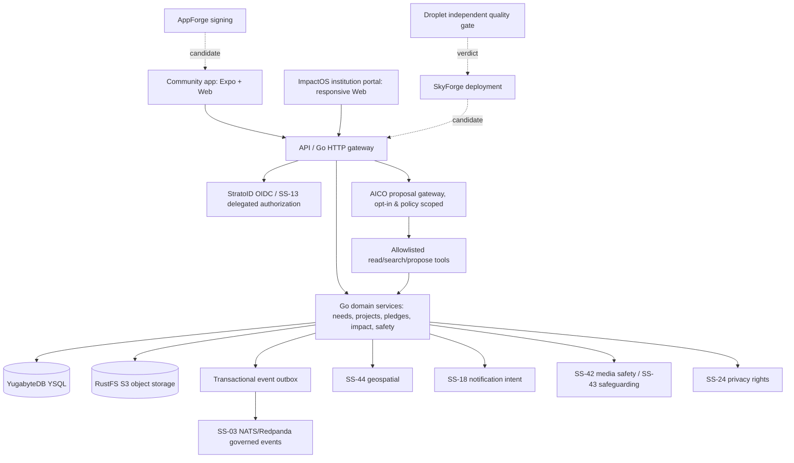
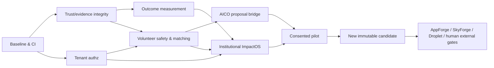

# iRespond — Complete Codex Engineering Handoff
**Version:** 2026-11-02  |  **Repository:** Atlasfsp/iRespond  |  **Status:** Engineering handoff only (GA is not certified)

**Important:** This document is a static snapshot for Codex to refresh against GitHub before edits. The 82 acceptance tests are NOT RUN and the 48 backlog items are NOT STARTED until real evidence is attached.

## Contents
1. 00_START_HERE.md
2. 01_MASTER_ENGINEERING_HANDOFF.md
3. 02_GA_AND_RELEASE_ENGINEERING.md
4. 03_ARCHITECTURE_AND_API_CONTRACTS.md
5. 04_TRUST_EVIDENCE_AND_SAFEGUARDING.md
6. 05_IMPACTOS_AND_IMPACT_INTELLIGENCE.md
7. 06_VOLUNTEER_MATCHING.md
8. 07_AICO_INTEGRATION.md
9. 08_90_DAY_EXECUTION_PLAN.md
10. 09_CODEX_EXECUTION_PROMPTS.md
11. 10_ACCEPTANCE_TEST_MATRIX.csv
12. 11_ENGINEERING_BACKLOG.csv
13. 12_SOURCE_AND_STATUS_MANIFEST.json
14. 13_RELEASE_DECISION_TEMPLATE.md

---


---

# Source file: `00_START_HERE.md`

# Start here — iRespond Codex Engineering Handoff

**Prepared:** November 2, 2026, Africa/Lagos  
**Purpose:** a practical, multi-workstream handoff for Codex to continue iRespond engineering, preserve existing releases and certify later releases correctly.  
**Output type:** plans, implementation prompts, acceptance matrix and dependency manifest; this package itself does **not** modify the GitHub repository or constitute GA certification.

## Quick start on MacBook
1. Locate your **existing** local `Atlasfsp/iRespond` Git working directory. Do not clone a second copy or reset ongoing local changes.
2. Extract this package into a separate folder under that repository, e.g. `.codex-handoff/irespond-2026-11-02/`. Keep `build/` generated test evidence out of Git unless explicitly approved.
3. Open Codex **at the existing repository root** and paste the `Compact master prompt` in `09_CODEX_EXECUTION_PROMPTS.md` or start with `PROMPT 0` and proceed in order.
4. Codex must first refresh repository/PR/candidate state and verify all exact SHA assumptions. These SHA values are snapshots and may change.
5. Do not alter frozen candidate or main directly; use feature branches, actual tests and normal branch-protected merges.
6. Do not enable paid GitHub Actions; use an **isolated Linux VM inside MacBook** for trusted CI, never a permanently exposed runner executing untrusted public PR code.

## Contents and suggested reading order
| File | What it provides |
|---|---|
| `00_START_HERE.md` | Entry instructions and versioned references |
| `01_MASTER_ENGINEERING_HANDOFF.md` | Mission, baseline facts, immutable boundaries, domain priorities and Codex autonomy limits |
| `02_GA_AND_RELEASE_ENGINEERING.md` | Runner, dependencies, CI gates, AppForge/SkyForge/Droplet, old/new candidates |
| `03_ARCHITECTURE_AND_API_CONTRACTS.md` | Components, YSQL/RustFS data contracts, proposed endpoints and ADRs |
| `04_TRUST_EVIDENCE_AND_SAFEGUARDING.md` | Threat register, evidence provenance, reviewer controls, C2PA and privacy tests |
| `05_IMPACTOS_AND_IMPACT_INTELLIGENCE.md` | Institution tenancy, programme UX, impact measurement and KPI definitions |
| `06_VOLUNTEER_MATCHING.md` | Consent-first Ability Profile, deterministic matching, fairness and fulfilment |
| `07_AICO_INTEGRATION.md` | AICO roles, agent gateway, human approvals, model selection and evals |
| `08_90_DAY_EXECUTION_PLAN.md` | Week-by-week schedule, milestones, owners, dependency network and go/no-go |
| `09_CODEX_EXECUTION_PROMPTS.md` | 13 sequential, copy-ready prompts plus compact master and emergency stop |
| `10_ACCEPTANCE_TEST_MATRIX.csv` | Test evidence matrix with pass/fail/blocked rows to be filled with real results |
| `11_ENGINEERING_BACKLOG.csv` | Ordered stories, issue links, dependencies and expected artefacts |
| `12_SOURCE_AND_STATUS_MANIFEST.json` | Verifiable source baselines and official references (dated snapshot) |
| `13_RELEASE_DECISION_TEMPLATE.md` | Real release evidence and decision worksheet |

## Exact existing references (as of November 2, 2026)
- Canonical GitHub: https://github.com/Atlasfsp/iRespond
- Main: `c12a4b5b8736700c2fdf2739fcd6f9a41c233521`
- Frozen GA certification reference: `6484873c8a0c3306a5972247bcc9981da4051bc6` (source), workflow `32952095093`, GA false (historical evidence).
- Current integrated visual PR: https://github.com/Atlasfsp/iRespond/pull/71; head `e1d9cb524164aa0e1c8fdaf0eb878c49dac80536`, unmerged and required checks blocked as verified.
- FIELDWORK design sub-PR #75 is already merged **into #71's feature branch**.
- Source issue references: [#53](https://github.com/Atlasfsp/iRespond/issues/53) external GA, [#72](https://github.com/Atlasfsp/iRespond/issues/72) Impact Intelligence, [#73](https://github.com/Atlasfsp/iRespond/issues/73) AICO & matching, [#74](https://github.com/Atlasfsp/iRespond/issues/74) ImpactOS, [#76](https://github.com/Atlasfsp/iRespond/issues/76) dependencies.

## Exit definition
**Engineering pilot ready** = implemented and source-verified capabilities, tested tenant isolation, privacy, consent, real programme and outcome evidence, human approvals and controlled pilot runbook. **Public GA** = all required external gates (and normal protected CI) certified against same exact new source SHA. These are **different milestones**. Keep `ga=false` until the latter is true.

## One-shot Codex start
```
Read all files in .codex-handoff/irespond-2026-11-02/ and execute
09_CODEX_EXECUTION_PROMPTS.md beginning with PROMPT 0.
Do not clone, overwrite work, force-merge, fake CI, turn on paid GitHub Actions,
expose personal Mac files, or change the immutable historical candidate.
Use existing Go/YugabyteDB/RustFS/Expo/StratoID/Shared Services. Open small
reviewable PRs with real tests and report exact source SHA and blockers.
```

The path above is a suggested extraction location, not a claim that the files have been installed on your MacBook.


---

# Source file: `01_MASTER_ENGINEERING_HANDOFF.md`

# iRespond — Autonomous Codex Engineering Handoff
**Programme:** Community Action Network → verified impact infrastructure  
**Baseline intelligence:** November 2, 2026 · Africa/Lagos  
**Audience:** Codex, engineering owner, release manager, privacy/safeguarding reviewers, product leadership  
**Mode:** Autonomous execution in auditable short-lived branches; gated promotion; never silent GA declaration

## Executive mandate
Build the next generation of **iRespond** without breaking the product that already exists. iRespond's differentiator is not crowdfunding or generic volunteering; it is the **complete, accountable community-action chain**: *see → report → verify → diagnose → plan → mobilize → act → measure → maintain → replicate*. Support individuals, community groups, NGOs, institutional foundations, universities and corporate CSR teams within one governed platform. Let **AICO** augment responsible human participants through explainable suggestions, translation, triage, coordination and impact analysis. Avoid fictional projects, inflated outcomes, automatic approvals, unlicensed payment activity and data disclosure.

**Canonical product doctrine:** “See it. Own it. Solve it. Prove the impact.” Response to Ability; 3P Action Compass (Place, Position, Possessions/Capabilities); community ownership; opt-in contribution; participant safeguarding; transparent evidence and sustained outcomes.

### Immutable repository/candidate facts — re-check before editing
| Item | Verified on 2026-11-02 | Treatment |
|---|---|---|
| Canonical repository | `Atlasfsp/iRespond` | Use the existing local repository; do not clone another copy. |
| `main` at retrieval | `c12a4b5b8736700c2fdf2739fcd6f9a41c233521` | Do not change directly; refresh from GitHub. |
| Frozen certification snapshot | `6484873c8a0c3306a5972247bcc9981da4051bc6` | Historical exact-SHA evidence; preserve unchanged. |
| Accepted frozen run | `32952095093` | Previously completed repository certification, **not** proof that new code is certified. |
| Frozen evidence artifact ID | `9600540959` | Archive; check SHA-256 `bddbebbeee35ec08cfb4ed71fa0e9505a43e69d7a9ad7c8d53a200fcb3d57f22`. |
| Frozen release decision | `READY_FOR_EXTERNAL_CERTIFICATION`, `ga=false` | Keep external gates pending. |
| Integrated UI PR | `#71` Horizon + FIELDWORK V2, head `e1d9cb524164aa0e1c8fdaf0eb878c49dac80536` at retrieval | One open PR, mergeable without code conflict, blocked by GitHub required checks. |
| FIELDWORK sub-PR | `#75` | Already merged **into PR #71's branch**, not into `main`. |
| Industry engineering issues | `#72` impact, `#73` AICO/matching, `#74` ImpactOS, `#76` dependency security | Build on these; avoid duplicates. |
| GA external tracker | `#53` | Remains open; immutable evidence policy. |

**Important distinction:** The historical candidate SHA is **not** current `main`. Do not label `c12a4b5` or PR #71 as the frozen candidate, and do not reuse the 6484873c evidence for a different tree. After source advances, create and validate a *new* candidate while keeping the historical artifact readable and attributable.

## Authoritative read order (do this before generating any code)
1. `git status --short`, remotes, default branch, latest heads and PR metadata. Preserve user's uncommitted work; stop destructive operations. Use only the existing iRespond folder, discover it rather than assuming a path.
2. `README.md`, `docs/GA_READINESS.md`, `docs/GA_EXTERNAL_CERTIFICATION_HANDOFF.md`, `config/ga/external-gates.json`, `services/api/openapi.yaml`, migration README, `services/api/internal/**`, `apps/web/**`, `apps/mobile/**`.
3. Draft feature sources from PR #71: `docs/product/IRESPOND_HORIZON_2026.md`, `docs/contracts/impact-outcome.v1.proposal.schema.json`, `docs/design/FIELDWORK_DESIGN_SYSTEM_V2.md`, `apps/web/fieldwork.css`, `apps/mobile/lib/fieldwork-theme.ts`, screenshots under `docs/screenshots/`.
4. `.github/workflows/{verify,web-verify,build-android-demo,docs-baseline-ownership,docs-interface-sync,living-manuals}.yml`, CI pinning and documentation baseline guards.
5. GitHub issues #53–#64, #71–#76, plus external AppForge `Atlasfsp/NexoCloud_AppForge#51`, SkyForge `Atlasfsp/NexoCloud-SkyForge#24`, Droplet `abiolaogu/Droplet#10`. These are *discovery references*, not authority to mutate external repositories automatically.
6. Read actual AICO/Nvuto/Shared Services contracts and current SDKs. Never guess AICO endpoints, assumed roles already registered, authorization keys, data schemas or provider capability.

## Hard invariants
- **Preserve the existing freeze:** no direct push to `main`; no overwrite/re-tag of frozen evidence; no false `ga=true`.
- **Canonical data/stack:** YugabyteDB **YSQL** as relational source of truth; **RustFS** through AWS S3-compatible SDK for immutable evidence bytes; Go services; React/JavaScript browser client; Expo Router/React Native mobile client; `pnpm@10.15.0`; Go `1.26.9` pinned in workflows; existing TypeScript/mobile dependency versions unless a tested migration is approved; event delivery via existing transactional outbox and SS-03 NATS/Redpanda when available.
- **Shared service responsibilities:** StratoID/OIDC and PKCE; SS-13 fail-closed authorization; SS-44 for enhanced geospatial; SS-18 notification intents; SS-24 privacy/data rights; SS-42 media-safety; SS-43 trust/safeguarding. Integrate with tenant-scoped workload identity; keep standalone fallback only where deliberately modeled.
- **Money:** initial candidate is **pledge-only**. A pledged amount is never payment, charge, settled receipt, held escrow or disbursement. Licensed PayCore/payment provider work is a separate regulated project and separate release scope.
- **Data and evidence:** distinct `observed`, `verification_requested`, privileged confirmation variants, `disputed`, `rejected`. Keep original verified uploaded bytes write-once; SHA-256 readback and moderation before authorized access. C2PA is an optional provenance signal; never equate metadata with factual truth.
- **Community protections:** affected-person consent; minors/vulnerable users; explicit crisis/harassment routes; safe coarse locations; prevent doxxing; never use AI to automatically approve evidence, publish accusations, reject beneficiaries or execute money movement.
- **Institutional security:** tenant boundary enforced in server and YSQL query predicates; global role alone grants no project resource authorization. Support denial/404 and document-level permissions.
- **GA and CI:** no bypass of protected-branch statuses; no fabricated CI green or fake screenshots; no `DO_NOT_SHIP` override; real AppForge/SkyForge/Droplet evidence required for external certification.
- **IP, licensing and UX:** FIELDWORK/Stitch are the current visual baseline. Use original licensed visuals; no copying Dribbble/Behance assets; accessible WCAG 2.2 AA aspirational browser requirement and actual mobile assistive tech tests; no speculative KPIs.
- **Operational safety:** use feature flags and migrations that allow safe rolling deployments; no irreversible schema break or data loss; observability must exclude secrets/PII.

## Workstream architecture and priorities

### P0 — source control, CI, release/candidate integrity
**Objective:** merge the integrated UI safely, eliminate dependency security regressions and reproduce the permanent CI jobs without buying GitHub-hosted minutes. MacBook Linux VM self-hosted runner must be isolated for public repo risk; verify whether GitHub Actions billing restrictions prevent even self-hosted jobs. Preserve build evidence and required status contexts. See `02_GA_AND_RELEASE_ENGINEERING.md`.

### P1 — Trust, Evidence and Safeguarding platform
Add provenance and evidence-review metadata *alongside* the existing evidence records; keep originals immutable; review/appeal and quarantine workflows; privacy redaction across exports and share links. C2PA optional and **not a truth oracle**. Threats include forged locations, synthetic humanitarian images, brigading, identity impersonation, abuse, duplicate project claims and collusive review. See `04_TRUST_EVIDENCE_AND_SAFEGUARDING.md`.

### P1 — Measured Impact Intelligence
Build durable baselines, output/outcome measurements, data provenance, reviewer attestations, beneficiary voice and post-project maintenance. Separate **reported activity**, **verified outputs**, **measured outcomes** and **causality claims**. Reuse Impact Passport as a summary of real source records. SDG mapping and UNV GIVE four dimensions are **conceptual analytical frameworks** until independently validated. See `05_IMPACTOS_AND_IMPACT_INTELLIGENCE.md`.

### P1/P2 — Volunteer & Skills Cloud
Extend Response-to-Ability with consented skills, availability, capacity, commitments and safeguarding checks. Start with deterministic and human-reviewed matching; later optional AICO reranking. No autonomous or mandatory behavioral profiling; transparent matching explanations and equitable access. See `06_VOLUNTEER_MATCHING.md`.

### P2 — AICO Action Intelligence
Use existing AICO role/employee capability registry where available, without creating a disconnected new AI employee silo. Introduce side-effect-free propose/evaluate flows, resource-scoped tools, audit, cost caps and human approvals. Model-provider routing follows validated quality/cost parity and BYOK policy. Failure degrades to rule-based/manual flows. See `07_AICO_INTEGRATION.md`.

### P2 — Institutional ImpactOS
B2B multi-tenant programmes: NGO/foundation/CSR/university portfolios, governed project rooms, approved invitations, contributor tasks, evidence reviews, measured outcome reports and maintenance dashboards. Begin with a *pilot*; don't ship complex institutional capabilities to the public UI without server contracts and permissions. See `05_IMPACTOS_AND_IMPACT_INTELLIGENCE.md`.

### P3 — Resilience and public expansion
High-risk emergency response needs crisis-specific partners, elevated safeguarding, location shielding, abuse prevention and relevant jurisdictional procedures. Keep public emergency escalation **out of MVP** until owner and drills exist. Optional public attestations, partner APIs and credential interoperability follow real demand, not demo enthusiasm.

## Non-negotiable execution sequence for Codex
**Step 0 — Discover.** Use `pwd`, `find`/`git`, `gh repo view`, `gh pr view`, branch and worktree checks. Write `build/handoff/baseline.json` from actual CLI commands. Stop if canonical repo identity doesn't match. Never discard local changes or blindly clone.

**Step 1 — Classify release tracks.** Track A = historical external certification for the frozen SHA; Track B = next candidate for post-PR-71 and new product slices. Draw a provenance graph: source SHA, tree SHA, image digest, Helm chart hash, artifact checksums, acceptance workflow ID, human decision. Never relabel Track A with Track B evidence.

**Step 2 — Reproduce CI locally.** Run offline/unit/static tests and production-like integration in an isolated Ubuntu VM with real YugabyteDB and RustFS; log evidence and toolchain versions. Do *not* change protected-branch settings to bypass failures. If GitHub self-hosted workflow scheduling is blocked by account billing, write a precise external blocker. Distinguish local PASS from GitHub required-check PASS.

**Step 3 — Resolve dependency findings.** Issue #76: validate `pnpm` config behavior; move supported overrides/patch config to `pnpm-workspace.yaml` where appropriate; regenerate lock deterministically; fix high vulnerabilities; preserve the Metro patch; exercise web, Expo/Metro, iOS/Android build where possible. Never suppress a security issue just to pass audit.

**Step 4 — Complete merged UI.** Ensure PR #71 includes FIELDWORK from PR #75; verify 91 design contracts; preserve genuine API-backed routes (45 user-facing operations), offline reports, NeedMap filters and Impact Passport. Test error/empty/offline/denied states, touch and keyboard/accessibility. Capture true desktop/browser, Expo web and real-device images with exact source SHA and method.

**Step 5 — Merge when allowed.** Fetch current PR head; compare/resolve conflicts; run all gates at exact head/merge result. Only normal GitHub merge with expected SHA after required statuses green, reviews satisfied. No administrator bypass. On merge, check new main tree/commit and immediately create a new candidate ledger. If blocked, don't claim merged.

**Step 6 — Deliver additive domain slices.** In narrow PRs: `impact-model` + migrations; `evidence-provenance`; `volunteer-profile-and-consent`; `deterministic-match`; `aico-proposals`; `institution-programmes`; `impact-reports`. Every PR adds OpenAPI, YSQL migrations, policy tests, E2E tests, docs, flags, rollback and measurable acceptance criteria.

**Step 7 — Run 90-day plan.** Use exact weeks/dependencies and go/no-go gates in `08_90_DAY_EXECUTION_PLAN.md`. Report daily useful engineering deltas, not fictional progress. Milestone quality overrides scope and dates.

## Required outputs from Codex
1. `build/handoff/repo-inventory.md` / machine-readable baseline (all commit refs real).
2. `docs/adr/` with decisions on identity, institution tenant model, evidence provenance, impact measurement, matching, AI delegation, finance pledge boundary and release control.
3. Updated API OpenAPI, request/response examples, generated contract smoke tests, DB migrations with downgrade/roll-forward plan.
4. Go domain modules + mobile/web screens + platform adapters + flags; all with tests.
5. Signed or hash-bound build/test provenance and PR links; CI runner evidence; artifacts not committed if secret/private.
6. `docs/ga/release-readiness.md` distinguishing automated, independent and launch approvals.
7. Screenshots from actual executable clients with SHA, device/viewport, sample data disclosure, dates and accessibility notes.
8. `docs/metrics/impact-kpis.md` containing definitions, denominators, observation windows and unknown-data handling; **no fabricated baselines**.
9. Pilot operation runbook with escalation, incident/abuse channels, privacy request SLAs where legally reviewed, on-call and community feedback.
10. `build/handoff/final-report.md`: completed/partial/not started, blockers, owner, next command, URLs and exact SHAs.

## Autonomy boundaries
Codex may author, test, open PRs and perform safe internal development. External legal, safeguarding, security, store, financial and institutional approvals must be obtained from actual responsible humans. Codex must **not** create fake approvals, invent acceptance evidence, force changes to personal Mac files, open an exposed public runner, manipulate branch-protection check statuses, or enable paid GitHub Actions without explicit user authorization.

## Definition of success
The initial UI PR is merged only when GitHub's **real** required check contexts have passed. The 90-day programme then yields a verified pilot-ready multi-tenant, evidence-aware and AI-assisted platform in a **new candidate** with real QA; GA remains **NO-GO** until independently certified, regardless of code completeness. Preserve `ga=false` until all relevant external gates are documented and approved.

### Reference index
- UN International Year of Volunteers 2026: https://www.unv.org/ivy2026
- 2026 State of the World's Volunteerism Report / GIVE: https://www.unv.org/sites/default/files/The%202026%20SWVR%20Web%20Version.pdf
- C2PA content credentials 2.2: https://spec.c2pa.org/specifications/specifications/2.2/specs/ContentCredentials.html
- C2PA explainer: https://spec.c2pa.org/specifications/specifications/2.2/explainer/_attachments/Explainer.pdf
- GitHub self-hosted runner security: https://docs.github.com/en/actions/reference/security/secure-use
- GitHub runner registration: https://docs.github.com/en/actions/how-tos/manage-runners/self-hosted-runners/add-runners
- OWASP AI security: https://genai.owasp.org/
- W3C WCAG 2.2: https://www.w3.org/TR/WCAG22/

> These industry signals inform product hypotheses and safeguards; they are not adoption, financial return or compliance certification evidence for iRespond.


---

# Source file: `02_GA_AND_RELEASE_ENGINEERING.md`

# Release engineering, immutable candidates, local MacBook CI and certification

## Release posture, as verified 2026-11-02
- Historical frozen candidate: `6484873c8a0c3306a5972247bcc9981da4051bc6`, run `32952095093`, artifact `9600540959`, decision `READY_FOR_EXTERNAL_CERTIFICATION`, `ga=false`. This is a dated prior reference, not the latest main tree.
- Main at retrieval: `c12a4b5b8736700c2fdf2739fcd6f9a41c233521`. PR #71 head: `e1d9cb524164aa0e1c8fdaf0eb878c49dac80536`. PR #75 already merged into #71, not into main.
- PR #71 currently has no reported merge conflicts, yet 6/6 required GitHub checks are failing because GitHub Actions jobs did not start. Owner identifies GitHub-hosted Actions payment as the barrier and authorizes **MacBook self-hosted runner only**, no paid minutes.
- Production dependency audit issue `#76`: high-severity vulnerabilities in prior lockfile; historical audit found ten high, eight moderate. Treat numbers as **as-of historical finding**, remeasure on exact current SHA. Do not auto-upgrade Expo/Metro blindly; preserve the Metro patch and SDK compatibility.

## Protect historical candidate, track new one separately
A certification *candidate* is the tuple `(source commit, tree SHA, CI run ID, toolchain versions, lockfile hash, image digest, Helm/package checksum, test evidence, human external approvals)`. An `accepted main` candidate is produced only by a green `main` push after the branch merge; a PR head or synthetic merge commit is `VALIDATION_ONLY`.

Codex MUST:
1. Capture SHA and tree identity before work; store no credentials in repo.
2. Preserve original issue #53, source commit, run, artifact and hash; do not edit to imply new changes passed historical external checks.
3. On merge, create new candidate with new exact source/tree/check identity. Preserve `ga=false`. Use `tools/release_evidence.sh`, `tools/dependency_inventory.sh`, `tools/ga_candidate_evidence.py` as intended, **after** building prerequisite artifacts.
4. Do not simulate `GITHUB_EVENT_NAME=push` or fake `GITHUB_REF=refs/heads/main` to manufacture `handoffEligible=true` in local evidence. Local tests are valuable but not an accepted release run.
5. Keep old-release rollback artifacts and documentation accessible. Any GA scope change (e.g., processing payments) opens its own release review.

## Faithful verification workflow map

| Workflow/job | Expected evidence | Blockers / environment |
|---|---|---|
| `verify.yml` / `mobile` | `pnpm install --frozen-lockfile`, Expo TS check, repository metrics | Node 22, pnpm 10.15.0 |
| `verify.yml` / `security-boundary` | `tools/security_boundary.sh`, pins, OpenAPI route contract | Bash/Python and exact pinned action constraints |
| `verify.yml` / `supply-chain` | `pnpm audit --prod --audit-level high`, Go verify + `govulncheck`, SBOM/dependencies, release + GA evidence | remediation #76, Go 1.26.9, Helm 3.18.4 |
| `verify.yml` / `api` | real YugabyteDB CI, real RustFS S3, migration twice, Go tests and vet, backup restore, HTTP load check, Docker image | Ubuntu Linux, Docker, pinned images, enough RAM/CPU |
| `verify.yml` / `deployment` | Helm lint/template, rollout safety, probes/HPA/PDB/network policy checks | Helm 3.18.4 |
| `web-verify.yml` / `web-contract` | browser syntax, FIELDWORK/Horizon, API coverage/execution, reachability, authz, offline demo | Node 22; no arbitrary network |
| `living-manuals.yml` / freshness + build-manuals | source-to-manual route/screenshot freshness; actual rendered documentation | Python, Playwright, Graphviz, LibreOffice, PDFs |
| `docs-baseline-ownership.yml` / baseline-ownership | base-controlled publication provenance and protected branch ownership | `pull_request_target` security; **never run untrusted PR code with write token** |
| `build-android-demo.yml` / offline-demo-apk | Expo offline demo, bundle/export, Gradle ARM64 APK and checksums | Linux, Java 17, Android toolchain, 45m job limit |

Check the actual required status names via GitHub branch protection/ruleset; do not infer “six” contexts from local filenames. The required set may change.

## MacBook strategy — secure by default
1. Locate existing repo without recloning, document `uname -m` (Apple Silicon x64/arm64) and Mac hardware resources. Minimize use of personal files; no desktop access permissions beyond what is required.
2. Create a **dedicated disposable Ubuntu Linux VM** (e.g. Lima or UTM), with explicit owner approval for VM creation and storage allocation. Use Linux inside the VM for all Ubuntu workflows; native macOS is used only for Apple signing, simulator or device testing when authorized.
3. Verify architecture compatibility for pinned YugabyteDB/RustFS image digests on Apple Silicon. If no compatible manifest or x86 emulation fails, use a compatible isolated Linux x86-64 environment approved by the owner; never silently replace immutable digests or lower integration quality.
4. Install GitHub's **official** runner from GitHub settings into the VM and register with a short-lived, user-provided token. Never paste tokens into Codex transcripts, files or logs. Restrict runner access to `iRespond` via runner groups or repo scope; use a runner account with minimal privileges, no host directory shares, no production credentials and ephemeral workspaces. Use self-hosted labels plus a custom verified label such as `irespond-ubuntu-ci`. Never set `self-hosted` as the only selector for unrelated jobs.
5. Because the repository is **public**, treat every external PR as attacker-controlled. The safest option is a disposable, one-job runner VM with fresh image per run and no long-lived trust. Where that cannot be achieved, do not run fork PRs, avoid `pull_request_target` executing PR code, do not mount Docker socket from macOS, prevent host secrets access, disable broad network egress, set restrictive token permissions and limit which workflow refs can execute. This risk is not solved by labeling the runner alone.
6. Test an isolated temporary smoke workflow on an **approved branch** after registering. If account billing still blocks GitHub workflow scheduling, document GitHub's message and stop trying to force statuses. Run independent local suites instead and leave protected PR unmerged.
7. Propose a reviewed workflow PR that changes `runs-on` to the restricted labels **for only applicable jobs**. Keep pinned `uses` SHAs, required job IDs/contexts, workloads and test commands. Beware that existing `tools/verify_ci_runtime_pins.sh` scans the workflow and must stay effective. Update the workflow itself only after smoke and security sign-off.
8. Keep `pull_request_target` baseline guard base-controlled; no untrusted head execution with `statuses:write`. Never issue success statuses manually. Preserve real check provenance.
9. Unregister runner and rotate credentials when work ends; remove VM snapshots that may contain repo tokens or private artifacts; retain sanitized immutable evidence only.

## Release gate procedure

**Gate R0 – Inventory**
- Confirm `gh repo view Atlasfsp/iRespond`, `gh pr view 71 --json ...` and exact current refs; verify clean working tree or avoid touching uncommitted work.
- Inspect existing requirement branch protection via GitHub UI/API with authorized access.
- Check source tree for unmerged PR #71 and its code dependencies; no force push.

**Gate R1 – Local source verification**
- Web: `node --check apps/web/app.js`, `node --check apps/web/stitch-catalog.js`, `node tools/verify_fieldwork_design.mjs`, `node tools/verify_horizon_experience.mjs`, `node tools/verify_web_frontend.mjs`.
- API coverage: `node tools/verify_frontend_api_coverage.mjs`, `node tools/verify_frontend_execution.mjs`, `node tools/verify_frontend_reachability.mjs`, `node tools/verify_frontend_authorization.mjs`, `python3 tools/verify_openapi_contract.py`.
- Offline: `node --experimental-strip-types tools/offline_demo.test.mjs` (Node 22 check for syntax/flag support).
- Mobile: `pnpm install --frozen-lockfile && pnpm mobile:typecheck`; run Metro startup, Expo dependency compatibility and device/simulator smoke.
- Security/pins: `bash tools/security_boundary.sh`, `bash tools/verify_ci_runtime_pins.sh`, `pnpm audit --prod --audit-level high` (**must succeed or explicitly block**).
- Go: `cd services/api && go mod verify && go test -p 1 ./... && go vet ./...`.
- Helm: `helm lint deploy/helm/irespond`, template and `tools/verify_deployment.sh`.

**Gate R2 – Real integration verification**
- Start actual pinned YugabyteDB/YSQL and RustFS **within isolated Linux Docker**. Ensure S3 signed PUT/GET, immutable upload, SHA-256 streamed readback and moderation.
- Migrate fresh schema twice, check idempotency and restore via `tools/verify_yugabyte_backup_restore.sh`.
- Negative tests: cross-tenant attempted data leaks, role bypass, evidence access prior to approval, duplicate event delivery, retry/cancellation, offline duplicate uploads, long-running task contention, crash/restart.
- HTTP load gate from canonical workflow: 300 requests, 20 concurrent, seed 40 needs, p95 ≤1000ms, throughput ≥20 req/s, 0 errors. This is a **CI regression threshold**, not global scale proof.
- Build production Docker image with pinned digest bases; no ignored failures.

**Gate R3 – Github required checks**
- Establish that **real** GitHub required check runs are green on the **exact current PR head** (not previously green on a different SHA). Verify automated docs and ownership policy too.
- Review any branch rule requiring human reviews, signed commits, linear history, DCO or code owners.
- Do not bypass check protection, create synthetic green `commit/status` or edit the ruleset. If status check scheduling is blocked for billing, report actionable admin instruction and keep PR open.

**Gate R4 – Merge / subsequent candidate**
- `gh pr merge 71 --merge` only after R0–R3, exact head revalidated and any current conflicts resolved. No force-merging to main.
- Verify merged state and new main SHA/tree in GitHub; rerun main-push CI and generate new accepted candidate **only if full required jobs green**.
- Link new candidate to original frozen SHA in the release ledger as superseding source only; historical GA evidence remains unaltered.
- Ship only after external R5 approval below.

**Gate R5 – External GA certification, tracked #53**
| Gate | Evidence required | Evidence owner |
|---|---|---|
| `stratoid-production` | OIDC registration, key rotation and outage behavior | Identity ops #54 |
| `shared-services-production` | workload identity; SS-18/24/43/44 security and endpoint integration | Platform #55 |
| `yugabytedb-production` | TLS, multi-zone, backup/PITR and dated restore | DB ops #56 |
| `rustfs-production` | TLS, multi-node/failure-domain/retention, recovery and upgrades | Storage ops #57 |
| `media-safety-production` | malware/format scanning, quarantine, moderation and deletion propagation | SS-42 #58 |
| `paycore-production` | **N/A only for pledge-only launch scope**, not PASS | Payments #59 / future scope |
| `mobile-stores` + `appforge-release` | real Apple/Google signing, privacy metadata, distribution evidence | AppForge #51 |
| `security-independent` | independent security testing, issue closure and risk acceptance | Security #60 |
| `device-accessibility` | real Android/iOS devices, assistive tech, low bandwidth/offline | Mobile #61 |
| `skyforge-production` | real deploy, readiness failure modes, canary rollback, network isolation | SkyForge #24 |
| `droplet-independent-verdict` | independent evaluation, no DO_NOT_SHIP/MERGE_BLOCKED | Droplet #10 |
| `operational-readiness` | on-call, incident response, capacity and escalation drills | Ops #62 |
| Legal/privacy/safeguarding | country-specific legal and human approval | #63 |
| Soak and capacity | production-class soak/saturation, restore and rollback | #64 |

Only authorized human owners can sign or waive scoped external gates. `config/ga/external-gates.json` is canonical; re-check identifiers before implementation.

## Evidence manifest shape (proposal, do not forge)
```json
{
  "schema": "irespond.release-candidate-manifest.v2-proposal",
  "releaseTrack": "next-candidate",
  "source": {"repository":"Atlasfsp/iRespond","commit":"<actual SHA>","tree":"<actual tree SHA>"},
  "ci": {"runId":"<actual successful run>","requiredContexts":["mobile","security-boundary","supply-chain","api","deployment","web-contract"],"allPassed":false},
  "artifacts": [{"kind":"api-image","digest":"<actual sha256>"}],
  "externalGates": {"certified":false,"evidenceRefs":[]},
  "ga": false
}
```

**Codex stop conditions:** missing genuine GitHub required check; security vulnerability at high/critical without accepted fix; failing tenant isolation or evidence immutability; undocumented new regulated money movement; missing production service dependencies; unapproved store/access token; conflicting branch state; loss of source-identity traceability.


---

# Source file: `03_ARCHITECTURE_AND_API_CONTRACTS.md`

# Architecture, Boundaries and Proposed API Contracts

## C4-level component picture



**ASCII fallback:** Expo/Web → Go API → YSQL + RustFS + transactional outbox; integrations with StratoID and Shared Services; AICO only through policy-scoped proposal gateway; AppForge/SkyForge/Droplet outside runtime.

## Services and authoritative ownership
| Bounded context | Existing/reuse | Proposed additive domain | Who may authorize writes |
|---|---|---|---|
| Needs | `services/api/internal/needs` | triage hints, review assignment | reporter for observations; verifier for states |
| Evidence | `internal/evidence` | provenance evaluation, redactions, attestations | authorized evidence reviewer, safety ops |
| Action Projects | `internal/projects` | programmes, tasks, milestones, planned outcomes | project resource ACL + institution membership |
| Contributions | offers/commitments in `internal/projects` | skill profiles, match proposals, availability | contributor opt-in; coordinator accepts with policy |
| Impact | `internal/impact/passport.go` | baselines, outputs, outcomes, maintenance and appeal | independent reviewer per outcome policy |
| Trust/safety | `internal/safety`, `internal/auth` | risk queue, synthetic media triage, safeguarding | delegated human trust reviewers |
| Privacy | `internal/privacy` | opt-in preferences, redaction and retention | data subject / lawful service roles |
| Finance | `internal/funding` | pledge reporting only | current safeguarded pledge policy; NO payments |
| AI | external AICO system (must discover) | proposal/feedback/evaluation bridge | delegated read/propose; human confirmation |

**First action:** extract actual authorization, event types and schema from existing Go services and migrations. These tables are proposed additions, not assertions that new code already exists.

## Source tree and migration plan
- Existing migrations `services/api/migrations/0001_core.sql` through `0010_platform_safety_subject.sql` on main. Reserve **0011+** for additive ordered, idempotent changes, after checking whether another branch already claimed them. Avoid overlapping migration numbers; use separate PR boundaries and an ADR.
- Use YSQL-compatible SQL and standard `pgx` path; do not install a parallel PostgreSQL or PostGIS authority.
- New data must carry stable UUID or existing canonical ID conventions; `tenant_id`/`institution_id` or explicit scoped identity; timestamp, actor, audit/version, privacy and retention metadata; logical deletion where data rights demand it.
- All user-to-org or volunteer-to-project joins must be scoped by tenant and resource permission. Test negative cross-tenant queries and event consumption. Consider YugabyteDB query indexing and global scale only after profiling.
- Atomic domain writes + outbox insertion in one transaction; consumer idempotency keys and replay defense; dead-letter and gap detection.
- Do not change response semantics for 51 registered OpenAPI method/path operations without versioned migration and compatibility tests.

## Proposed new resource contracts (draft; refine against existing OpenAPI)

### Institutions & programmes
| Method | Route candidate | Purpose | Security rule |
|---|---|---|---|
| POST | `/v1/institutions` | Create or request verified organization | authenticated, independent approval where required |
| GET | `/v1/institutions/{id}` | Institution summary | public safe projection or tenant membership |
| POST | `/v1/institutions/{id}/programmes` | Create scoped programme | explicit org role + policy decision |
| GET | `/v1/institutions/{id}/programmes` | List tenant-scoped programmes | tenant-scoped projection |
| POST | `/v1/programmes/{id}/tasks` | Create volunteer opportunity | project coordinator, review flags |
| POST | `/v1/programmes/{id}/members/invitations` | Invite by consent | manage_members permission; abuse rate limits |
| GET | `/v1/programmes/{id}/report` | Generate human-readable evidence report | report scope, redaction, reviewer state |

### Ability profile / matching
| Method | Route candidate | Purpose | Security rule |
|---|---|---|---|
| GET/PUT | `/v1/me/ability-profile` | Consent and abilities | subject owner only, minimal public projection |
| POST | `/v1/opportunities/{id}/matches/evaluate` | Deterministic eligible options | coordinator or participant; consent scoped |
| GET | `/v1/me/match-recommendations` | Private personalized recommendations | user-owned and consent gating |
| POST | `/v1/opportunities/{id}/applications` | Volunteer intent | user request, idempotency key |
| POST | `/v1/applications/{id}/decision` | Offer/accept/decline | delegated coordinator; reason, audit |
| POST | `/v1/applications/{id}/fulfilment` | Record completion and evidence | distinct reviewer/fulfiller authority |

### Evidence integrity / outcomes
| Method | Route candidate | Purpose | Security rule |
|---|---|---|---|
| GET | `/v1/evidence/{id}/provenance` | Moderation-safe evidence provenance | explicit reviewer/approved public projection |
| POST | `/v1/evidence/{id}/review` | Human review + source trace | reviewer separation, safe state transitions |
| POST | `/v1/projects/{id}/outcomes` | Propose measured outcome | project owner, cannot self-publish |
| POST | `/v1/outcomes/{id}/attestations` | Reviewed outcome attestation | authorized independent reviewer |
| POST | `/v1/outcomes/{id}/challenges` | Community appeal | authentic subject and rate limits |
| POST | `/v1/outcomes/{id}/maintenance-reviews` | Follow-up durability assessment | maintenance owner + review policy |
| GET | `/v1/projects/{id}/impact-report` | Authorized report | versioned, redacted, provenance disclosures |

### AICO assistant
| Method | Route candidate | Purpose | Security rule |
|---|---|---|---|
| POST | `/v1/ai/proposals` | Triage or task/match/impact proposal | per-user consent, tenant-scoped tool policy |
| GET | `/v1/ai/proposals/{id}` | Status and citations | request author / delegated coordinator |
| POST | `/v1/ai/proposals/{id}/decisions` | Human accept/reject/edit | separate human, result auditable |
| POST | `/v1/ai/proposals/{id}/feedback` | Calibration and measured correctness | opt-in, no sensitive leakage |

These are **not committed endpoints** and should not be added wholesale. PR owners must inspect actual route handlers, name conflicts, OpenAPI conventions, pagination, auth headers and error shape; then author ADR and compatible schema before development.

## Cross-cutting API contract invariants
1. Authentication: existing StratoID/OIDC JWT validation, tenant context and `SS-13` authorization decisions must be enforced server-side. Reject unknown/expired/forged identities; denial must be auditable.
2. Error envelope: re-use current canonical errors (401,403,404,409,422,429,503); avoid leaking a resource's existence to unauthorized actors.
3. Idempotency: apply `Idempotency-Key` for state-changing creation, with TTL/replay semantics; retried offline submissions must not duplicate reports, payments or contributions.
4. Data minimization: geolocation is coarse or withheld by policy for public queries; sensitive attributes are not sent to models.
5. Pagination/sorting and rate limits; don't fetch whole tenant tables.
6. Date/time: timestamp UTC; local time localized in clients; consistency on expiry/appeal windows.
7. Event payloads: no raw personal contact details, public exact coordinates or secrets in outbox events.
8. Migration compatibility: old Expo releases may coexist while new API deploys; additive endpoints and fields first, staged enforcement later.
9. Feature flags: `impact_intelligence_v1`, `volunteer_matching_v1`, `aico_proposals_v1`, `institution_pilot_v1`, `provenance_c2pa_v1`. Default **off** until contract and approval.
10. Observability: structured audit vs operational logs separated; prevent PII in traces and metrics; bounded dimensions.

## Developer experience and frontend
- Keep the original FIELDWORK tokens, semantic contrast and transparent states. Build shared visual components rather than duplicating CSS/React Native designs with unrelated labels. Existing web `stitch-catalog.js` and Expo routes must still resolve.
- Keep mobile offline queue, location review and deferred retries. Provide states for `no available matches`, `no eligible contributor`, `pending reviewer`, `sensitive location hidden`, `model unavailable` and `measurement missing`.
- No “volunteer matched”, “verified outcome”, “donation received” or “95% impact” displays without corresponding real approved records.
- Accessible labels, focus order, keyboard interaction, VoiceOver/TalkBack, 44px+ controls, disabled states, low-bandwidth and language support including right-to-left when used.

## Architecture ADRs to author first
- ADR-001: Track A immutable certification vs Track B new release.
- ADR-002: Institution tenancy and scoped policy model.
- ADR-003: Write-once evidence bytes + optional credentials/provenance + review.
- ADR-004: Outcome semantics, measurement lifecycle and non-causality defaults.
- ADR-005: Opt-in ability profiles and matching transparency.
- ADR-006: AICO delegated proposal-only gateway and human approvals.
- ADR-007: Pledge-only finance boundary.
- ADR-008: MacBook runner isolation, public-fork threat model and GH required contexts.
- ADR-009: Data rights/deletion with immutable audit and backup/retention.
- ADR-010: Pilot launch jurisdiction, incident/abuse and escalations.

## External integrations: ownership and proof
- **Nvuto/Shared Services:** discover actual contracts/SDKs, then make a tenant-isolated adapter; unavailable or uncertified services must fail safely. No hidden local mock in production.
- **AICO:** discover canonical AI employee registry and orchestration contract; do not assert existing 30k+ AI employees can perform these tasks without skill validation. Attach evaluation and escalation traces.
- **GrowthOS:** opt-in partner onboarding/campaign integration only after approved programme and consent, no automated publicity about vulnerable people.
- **NexoCloud:** SkyForge runtime, AppForge mobile, Droplet release; neither is GA evidence absent independent run.
- **Institutional provider integrations:** import/export via auditable connectors with consent and rate-limit; defer CRM/HR sync until tenant agreements and data mapping exist.


---

# Source file: `04_TRUST_EVIDENCE_AND_SAFEGUARDING.md`

# Trust, Evidence Integrity, Community Safety and Provenance — Engineering Pack

**Priority:** P1. **Tracked by:** GA #53, external SS-42 #58, SS-43 shared services, proposed ADR-003, Impact Intelligence #72. **Existing foundation:** `internal/evidence`, `internal/safety`, `internal/needs`, `internal/privacy`, `internal/auth`, RustFS, YugabyteDB.

## Problem statement
AI-generated imagery, misleading location/context, duplicate submissions, collusive review and fake programme claims can undermine humanitarian credibility. Treat an uploaded image, narrative or GPS coordinate as **reported information**, not proof of truth. Evidence integrity must preserve bytes and audit decisions while also protecting survivors, vulnerable people and confidential reporters.

## Existing guarantees to preserve
- Pre-signed **create-only** RustFS uploads using standard AWS S3 SDK; evidence can have SHA-256 byte verification after completion; mismatched object is rejected.
- Status-based moderation before signed download and access; permission check cannot be bypassed by knowing an ID.
- YSQL storage; privilege separation for verification transitions; signed access only after appropriate approval.
- Confidential safeguarding case workflow, appeals and audit; SS-42/SS-43 external production certification still outstanding.
- Data access/export/correction/deletion request workflow and recorded consent.

## Threat register and responses
| Threat | Attack pattern | Proposed response | Must not do |
|---|---|---|---|
| Synthetic/disinformation media | generated flood imagery or altered document | provenance parse + independent corroboration + reviewer | assume AI detection is definitive |
| Location spoofing | image from elsewhere or GPS spoof | coarse public point, suspicious flag, on-site reviewer | publish precise vulnerable-site coordinates |
| Collusion | a reporter self-reviews or coordinated friends confirm | role separation, conflict of interest, reviewer audit | allow self-attestation to count as independent verification |
| Evidence overwrite | re-upload after approval | write-once object key, digest match and version binding | replace object bytes in place |
| Reuse/double count | same media for multiple needs | similarity hints and human case linkage, hash dedupe within lawful scope | delete legitimate duplicates automatically |
| Malware/media exploit | encoded exploit in photo/PDF/video | quarantine, content/mime checks and SS-42 scan | publicly serve pending media |
| Doxxing/targeting | public child/beneficiary faces or exact locations | safety labels, consent, redaction, private reviewer envelope | grant AI access to precise location by default |
| Prompt injection | malicious text on uploaded flyer | treat file as untrusted data, tool/response boundary | allow model instructions from evidence to trigger writes |
| Evidence exfiltration | scraped signed URLs or guessed IDs | short expiry, scoped auth, no secrets in events/logs | share direct RustFS credentials with clients/AI |
| Deletion conflict | retention law vs user request | documented legal hold, cryptographic access revocation, retention status | promise full deletion of immutable backups immediately |
| Fraudulent funding | claim pledge == received money | pledge state explicit, no payment status inferred | issue fictitious receipts |
| Misleading outcomes | outputs presented as attributable durable change | measurement grades, reviewer, caveat | invent universal impact score |

## Proposed schema: `evidence_provenance`
Before authoring a migration, inspect existing `evidence`/`need_evidence` columns. Use an additive table or columns with no duplicate authority:

- `evidence_id` FK to existing evidence ID, `tenant_id` or authorized project scope.
- `object_sha256_hex` (only computed from actual stored bytes), `byte_size`, `media_type`, `original_object_version_id` where RustFS supports it.
- `capture_claims_json` (EXIF/C2PA/submitter claim; quarantine personal fields), `capture_trust_level` enum **claim_only / device_attested / third_party_attested / unknown**. Neither establishes content truth.
- `c2pa_status` enum `not_checked`, `absent`, `valid_signature`, `invalid_signature`, `unsupported`, `parse_error`; `c2pa_manifest_hash`, validation timestamp and verifier version.
- `scan_status` pending/clean/quarantined/blocked; `scan_refs` nonpublic; `review_status` pending/approved/restricted/rejected; `reviewer_id`, COI declaration and reason.
- `redaction_policy_id`, `public_preview_id`, retention/legal_hold and deletion_state; avoid mutating original byte hash.
- Append-only `evidence_reviews`, `evidence_challenges`, `evidence_audit_events` with actor, action, prior/new state, reason, timestamp, safe metadata, outbox event ID.

Never expose private policy/evidence scan results through a public `GET` or AICO tool. Use a safe server-generated public projection with explicit approved fields.

## C2PA contract — modest by design
1. Optional ingestion of Content Credentials; verify signature against configured trust store and policy where supported.
2. Store both verification **result** and parser limitations; treat unknown/missing credentials neutrally.
3. Display “Content provenance information available” only for actual verified metadata; never “photo verified true.”
4. Make provenance portable via stable content hash and signed attestations, **without publishing contributor identities** unless consented.
5. Retain independent verification: cross-source review, site visit, expertise, community challenge and evidence lineage.
6. Sandbox parsers and cap CPU/memory/file sizes; fuzz malformed manifests and decompression bombs.

**Primary source:** C2PA 2.2 explainer explicitly warns that provenance cannot establish whether media depicts truth: https://spec.c2pa.org/specifications/specifications/2.2/explainer/_attachments/Explainer.pdf

## Human review workflow
```
observed evidence → upload initiated → uploaded/completed → hash-integrity verified
  → media quarantined + SS-42 scanning → reviewer queue → approval/restriction/rejection
  → request for clarification or appeal → signed limited access → follow-up and retention
```
- Require independent reviewer role and conflict check for material confirmations; avoid same person submitting and approving.
- High-risk humanitarian/safeguarding report: immediately restrict public visibility and notify trained trust staff, not a public feed.
- Record state transition with idempotency and outbox; restore consistency on outbox replay.
- Community challenges should be low friction but rate-limited against harassment; distinguish genuine feedback from verified findings.
- Provide protected appeal and correction rights; audit reviewer decisions and publication/withdrawal.

## Location and identity privacy
- Allow a reporter to confirm an intervention coordinate accurately while using a separate **public display location** policy, such as ward/city area. High-risk location never enters public API, logs, AI prompt or push notification.
- For minors, survivors and emergency shelters, never publish precise addresses or sensitive faces by default. Mask metadata such as EXIF GPS in public previews without modifying original forensic evidence record.
- Audit scopes at institution, programme and project level; revoke links when evidence moderation state changes; default access denied if SS-13 unavailable.
- Ensure deletion/consent withdrawal propagates across cached thumbnails, search index, exported reports and relevant AICO retrieval index, subject to legal retention rules.

## Tests and adversarial fixtures
- `CreateOnlyUpload`: second PUT cannot overwrite approved source; digest invariant remains stable under parallel retry.
- `HashMismatch`: declared digest != RustFS bytes; fail upload completion and prevent moderation/download.
- `UnauthorizedSignedRead`: no signed URL for unauthenticated/insufficient role, even if ID known.
- `CrossTenantEvidence`: org A cannot read/review organization B evidence (also SS-13 unavailable fail closed).
- `ReviewerSeparation`: reporter cannot independently audit own evidence; invalid state transition fails.
- `C2PAAbsent`: remains UNKNOWN, never rejected solely for missing credentials.
- `C2PAInvalid`: flag signature invalid without asserting content false.
- `SyntheticMedia`: label as suspicion pending human review; no automated punitive action.
- `LocationLeak`: search/export/notification/AI request never expose original high-risk coordinates.
- `DeleteCascade`: affected person requests deletion; propagates through derived material consistent with legal hold.
- `PrivacyBackups`: audit no false promise of immediate purge from immutable backups.
- `MediaMalware`: quarantine, no public access, manual escalation.
- `AppealAndDispute`: append-only corrections and publication state changes, duplicates idempotent.
- `TaintedFileInjection`: uploaded text instructs agent to send credentials; no tool execution.

## Deliverables and acceptance
- ADR and threat model; DB migration with data backfill plan; Go service adapters and OpenAPI docs; SS-42 integration contracts; human reviewer UI; redaction policy; outbox events; logs/metrics; replay and safety tests; accessible mobile/web statuses; rollback runbook.
- **Exit gate:** real RustFS integration, complete byte lineage, unauthorized access blocked, no privacy leak, human reviewed case, independent review and appeals demonstrated; vulnerability scan/pen test evidence recorded. External SS-42/43 certification remains pending even if these tests pass.

## Codex execution prompt
> Inspect current RustFS evidence service, safety/consent endpoints and migrations. Author ADR-003 and a threat model with the attack cases above. Implement the smallest additive provenance and review slice using Go, YSQL, SS-13, SS-42/43 and the transactional outbox; preserve immutable SHA-256 upload binding. Write adversarial integration tests before any public UI; add optional C2PA only if supported safely. Never equate C2PA metadata with factual truth and never expose exact vulnerable-person locations. Keep fields and endpoints feature-flagged; show evidence-quality labels only from actual server records. Open a narrow PR and report the independent production gate status without marking it PASS.


---

# Source file: `05_IMPACTOS_AND_IMPACT_INTELLIGENCE.md`

# ImpactOS & Impact Intelligence — Institutional Product + Measurement Engineering

**Priority:** P1 impact foundation; P2 institution pilot. **Issues:** #72 (measured outcomes), #74 (institutions), related #53 GA. **Reuse:** YSQL, `internal/projects`, `internal/impact`, `internal/funding`, verified evidence, audited role policy and existing Impact Passport. **No second standalone ERP.**

## Product architecture and packaging
- **iRespond Community**: public discovery/report/contribution, project participation, verified Impact Passport.
- **ImpactOS for institutions**: multi-tenant programme portfolios for NGOs, charities, foundations, CSR teams, universities and community associations; project rooms, milestone/task allocation, volunteer engagement, evidence review, outcomes and maintenance. Launch this as an edition of iRespond, not independent conflicting database.
- **Trust & Impact Registry** (later): consent-safe attestation and exported audit record for eligible verified work, not a token system or automatic government recognition.
- **Resilience** (later): safeguarded crisis coordination only after local owner training and emergency controls.

Institution tiers should be tested with pilots; don't invent prices, ROI, logos, volunteer counts or customer commitments. First target 1–2 pilot institutions with clear records and actual users before adding broad verticals.

## Domain model proposals
### Institution foundation
- `institutions`: id, legal_display_name, verification_status, tenant_id, domain, country, privacy classification, created_by, approved_by, timestamps.
- `institution_memberships`: principal, organization, role, invitation/accept state, expiry, consent, auditor.
- `programmes`: institution scope, outcomes hypothesis, public/private campaign description, project IDs, budget *pledge* fields (not funds received), period, owner, risk category, publication policy.
- `programme_tasks`: action project ID, skill requirements, safe location, capacity, eligibility/safeguarding, duration, due date, state and assigned coordinator.
- `programme_reports`: versioned source refs, generated summary, redaction/audit, review state, export hash, date and actor.
- `beneficiary_feedback`: consented feedback with sensitivity and redaction; do not make participation conditional on public testimonial.

### Evidence-based impact domain
Define `intervention_goal`, `baseline_observation`, `indicator_definition`, `measurement_observation`, `outcome_claim`, `review_attestation`, `community_challenge`, `maintenance_review`, `attribution_assessment`.

**Measurement semantics**:
- *Activity* = volunteer event/project task took place; not yet outcome.
- *Output* = delivered goods/services or hours logged, supported by evidence.
- *Outcome* = measured change for affected group over time, with baseline/denominator/method.
- *Attribution* = evidence of causal contribution; unless supported by rigorous methodology, label **descriptive** or **contribution-assessed**, not causally proven.
- *Durability* = follow-up/maintenance evidence at dated intervals, not guaranteed perpetuity.

Example: “40 volunteers cleaned a drainage channel” may be a **verified output** with attendance and media; “flood incidents decreased” is **an outcome hypothesis** until baseline, time window, comparison, environmental covariates, measurement method and independent reviewer exist. A dashboard must not collapse these into a single unsupported point score.

## Outcome JSON schema and migration path
PR #71 already contains a **proposal only** at `docs/contracts/impact-outcome.v1.proposal.schema.json`. Treat it as an architectural input, **not** a production API contract. Modify the proposal via ADR, connect to actual `internal/impact`, and add versioned tables and HTTP methods incrementally. Require:

- `indicator.kind` `output | outcome | maintenance`, named units and population denominator.
- `baseline`, `target`, `measurement` values, dates, methods, sampling and caveats.
- Evidence IDs with immutable SHA-256 and reviewer states; allow missing baselines but label them unknown.
- `review.state` `draft → submitted → under_review → approved/disputed/rejected`; lawful appeal and corrections.
- `privacy` classification, consent, publicity permission, safe geo precision and retention.
- `attribution.claimLevel`: `descriptive | contribution_assessed | causal_estimate` plus method approval/reference.
- SDG tags (1–17) and conceptual UNV GIVE tags: value to individual, community, economic value, enabling environment.
- Maintenance due date with follow-up cadence and evidence.
- Audit trail, writer/reviewer separation and optimistic concurrency or YSQL locks.

The UNV 2026 SWVR describes GIVE as a four-dimensional volunteer-engagement framework. iRespond's conceptual mapping **does not** mean GIVE is an official accreditation, comparable universal metric or causal certification. See https://www.unv.org/sites/default/files/The%202026%20SWVR%20Web%20Version.pdf.

## Institutional journey end-to-end
1. Org owner applies; human validation of legal identity/appropriate controls.
2. Tenant-scoped admin activates institution and members; StratoID and SS-13 authorize every programme/project action.
3. Coordinator creates programme and explicit hypothesis, indicators, baseline plan, safeguards and approval policy.
4. Community participant reports need; verification remains separate. Project converts from confirmed need only.
5. Team creates volunteering opportunities; eligibility and matching are consented and explicit; invitation limits.
6. Contributor commits; coordinator accepts; fulfilment evidenced and reviewed.
7. Reviewer validates output evidence; outcome assessor separately records measured change with uncertainty.
8. Beneficiary/community voice can challenge a misleading outcome; programme owner corrects report/version.
9. ImpactOS generates privacy-safe report; provenance and denominators visible; missing data prominent.
10. Maintenance owner performs dated follow-up; completed work can later be replicated with a new evidence lineage.

## UI views and role permissions
| View | Who sees it | Required data state |
|---|---|---|
| Community report | public safe projection | unverified labeled until review |
| Programme portfolio | institution member | tenant and role filtered |
| Opportunity detail | eligible participant, safe public | published tasks and coarse location |
| Task assignment | authorized coordinator | accepted actual volunteer commitments |
| Evidence-review queue | reviewer/safety team | pending, quarantined and accessible by policy only |
| Outcome measurement | project owner drafts; reviewer approves | named baseline, evidence, sampling, missingness |
| Impact Passport | contributor | source-evidenced activities and verified output; measured outcomes separately |
| Funding/pledges | entitled stakeholders | commitments only; no settlement language |
| Quarterly institutional report | approved report audience | version, date, methodology, caveats, redacted evidence |

## Pilot deployment
**Suggested initial segments:** NGO/foundation partner, corporate community-impact programme, and university service learning; select at most two to validate operations. Assign signed owner for beneficiary privacy, safeguarding and data retention.

Pilot must use consenting real participants and an approved low-risk action (e.g. community cleanup or school equipment maintenance). Avoid first pilots involving emergency rescue, minors' medical conditions, trafficking or protected locations.

## Measurement design and metric dictionary
| Metric | Definition | Denominator / evidence | Guardrail |
|---|---|---|---|
| Valid report rate | reports with valid coordinate/consent/evidence fields / submitted reports | all actual attempts, time window | duplicates tracked, not hidden |
| Verification lead time | creation → authorized outcome of review | cohort of reports entering verification | don't measure only approved reports |
| Verified response rate | needs with actual accepted response in interval / eligible verified needs | eligible cohort | separate rejected/disputed |
| Match acceptance | accepted match proposals / consented delivered proposals | eligible shown recommendations | report opt-outs and bias |
| Fulfilment | fulfilled commitments / accepted commitments | original accepted cohort | failed/cancelled explicit |
| Evidence coverage | reviewed output items with valid evidence / claimed items | item and project sample | hash/reference verified |
| Baseline completeness | outcome claims with valid pre-intervention baseline / outcome claims | defined claims | no fabricated baseline |
| Outcome change | follow-up measurement minus baseline, context-specific | indicator and cohort | note sampling and confounders |
| Durability | maintained interventions at 30/90/180 days / those due for review | follow-ups due in period | missing counts as unknown, not success |
| Equity and accessibility | measured task completion/perceived burden across consented groups | eligible accessible sample | minimize sensitive demographic data |
| Cost per evidenced outcome | approved programme costs / evidence-backed outcomes | denominators named, currency and period | avoid cross-programme ranking without method |

Proposed threshold examples (not actual results): 100% cross-tenant access denied in negative tests; 0 unsupported payout states; 100% approved claims have reviewer/audit trace; 100% new programme public reports have publication policy. Pilot conversion and retention targets should be set **after** baseline measurement, not invented.

## Quality and external decision gates
- Additive YSQL migrations and rollback, idempotent creation, lock and event tests.
- Negative tests for tenant crossing, forged org invites, coordinator self-approval, unapproved evidence, role drift, report export privacy and appeal.
- E2E instrumented scenario: need → verified → project → task → volunteer → fulfilled output → outcome measurement → reviewed report → 90-day maintenance.
- Genuine experience research: role-based desktop and mobile workflows, accessibility, localization and low-bandwidth paths.
- Pilot acceptance from institution owner + community beneficiary representatives and legal/privacy oversight.
- Independent verification and external GA remain separate; successful pilot does not make all of iRespond GA.

## Codex execution prompt
> Inspect current YSQL migrations, project roles, funding pledge domain, Impact Passport and proposal schema. Draft ADR-002/004 and implement an additive tenant-isolated Impact Intelligence foundation on short-lived branches. Integrate real source-evidenced outputs, approved outcome measurements, beneficiary challenges and maintenance reviews. Separate reporter, coordinator and independent reviewer permissions. Then deliver a permission-governed institutional ImpactOS pilot with programme/tasks/reporting, preserving FIELDWORK UX. No fabricated analytics; pilot KPIs show “not yet measured” until real data exists. Require human sign-offs and tests before exposing institution features. Link delivery to GitHub issues #72 and #74.


---

# Source file: `06_VOLUNTEER_MATCHING.md`

# Volunteer & Skills Cloud — Opt-in Matching Architecture

**Priority:** P1/P2 after trust foundation. **Issue:** #73. **Core doctrine:** Response to Ability and 3P (Place, Position, Possessions/Capabilities).

## Product promise
Help people make real, useful contributions based on time, skills, accessibility needs, capacity and safe location constraints. Do not use misleading “AI matched” labels when no placement occurred. A recommendation is **not** an invitation, an accepted invitation is **not** fulfilled work, and completed work is **not** automatically independently verified community impact.

## Participant-centred domain entities
| Entity | Fields / lifecycle | Privacy and policy |
|---|---|---|
| Ability Profile | opt-in skills/tags, validated credentials only if appropriate, languages, remote/on-site, availability windows, access requirements, preference categories, capacity/maximum commitments, profile updated time | subject owns it; consent; no public sensitive attributes |
| Opportunity | verified project/programme ID, task category, essential/optional skills, location policy, equipment/safeguarding needs, time window, team capacity, visibility | coordinator authorized, review before public display |
| Recommendation | requested by, opportunity ID, fit reasons, model version if any, explanation, timestamp, feature sources, consent scope, expiry | only subject/authorized coordinator; no raw private signals in logs |
| Application | person indicates interest, optionally supplies qualifications, status: applied/invited/accepted/declined/cancelled | idempotency, anti-harassment |
| Assignment | coordinator approves acceptance, dates, safe site details, cancellation reason, audit, check-in/out when lawful | no location reveal before approval |
| Fulfilment | task actions, duration if relevant, evidence refs, coordinator/reviewer state | evidence access reviewed; no automatic passport award |
| Matching Audit | eligibility set, rule version, fairness snapshot aggregate, human override reason | protected; pseudonymized, retention |

## Algorithm phased delivery
**Phase 1, deterministic eligibility and ranking** — do before AICO:
1. Eligible if user opted in and consent active; opportunity is published and safe; age/safeguarding/permission policies satisfied; capacity not full; date constraints compatible.
2. Hard exclusions: no consent, inappropriate age or clearance, disallowed identity/tenant, protected location conflict, required certification absent (where verified), prior volunteer opt-out.
3. Score only among eligible candidates, e.g. essential skill coverage 35%, availability overlap 30%, accessibility/format fit 15%, preferred cause alignment 10%, travel burden 10%. **These are trial weights only**; tune with user studies and real opt-in outcomes. Accessibility needs should guide accommodation and never unfairly lower candidate eligibility.
4. Use coarse user-chosen location bands, not exact home coordinate; do not publish full volunteer location to coordinators before consent.
5. Explain scores in plain language: “Your available Saturday window and first-aid training align with this approved programme”; avoid hidden sensitive inferences.
6. Support self-browse and manual coordinator matching for all participants, regardless of AI access.
7. Restrict outreach: per-person weekly contact ceilings, opt-out, silence-hours handling, complaints, block/coordinator reporting.

**Phase 2, proposal-only AI reranking**
- Let AICO identify semantic skill equivalence and alternatives to rigid labels; constrain it to vetted, minimally necessary features.
- It may propose contact, never send without human authorization; no automated discrimination, rejection or unsafe transportation decisions.
- Keep deterministic decisions and explanation available if AICO is disabled/unavailable. Monitor measured gains, false matches, refusals, and volunteer dissatisfaction.

## Fairness and accessibility
- Skills-based matching is useful but can disadvantage informal community expertise. Include **self-declared local knowledge**, lived experience, languages, care, availability and possessions/capabilities with suitable verification labels.
- Avoid requiring certificates for harmless work; require legitimate safeguarding/certification only when task risk demands it.
- Do not infer age, disability, ethnicity, migration status or socioeconomic background from behavior. Any legally relevant restriction should be an explicit approved policy, not model inference.
- Support low-data/offline application queues, accessible invitation prompts, phone/SMS only with consent and compliant providers, and calendar/time zone display.
- Human moderation for urgent care, emergencies, contact with children or exposed vulnerable persons; exclude from the initial automated pilot.

## Side-effect and audit contract
An assistant can return an immutable `MatchProposal` with `eligible=true/false`, explanation, reasons and confidence, but it **cannot** create `Assignment` until authenticated person/coordinator confirms. Auditable transitions:
```
profile_opt_in → proposal → participant_interest → coordinator_review
    → accepted_assignment → check-in/task activity → evidence_submission
    → independent_review → fulfilled_or_disputed → impact_passport_projection
```
Every transition has actor identity, policy decision, version, idempotency key and outbox event. Refuse `submitted` → `fulfilled` without authorized real evidence state.

## API/state design notes
- `PUT /v1/me/ability-profile`: allow partial update, consent version and withdrawal, actor=self.
- `POST /v1/opportunities/{id}/applications`: idempotent self-application with server eligibility enforcement.
- `POST /v1/opportunities/{id}/matches/evaluate`: candidate-only ranking/proposal in scoped context; no PII in external model prompt by default.
- `POST /v1/applications/{id}/decision`: coordinator authorization, reason and non-discrimination oversight.
- `POST /v1/applications/{id}/fulfilment`: evidence IDs, reviewer-controlled actual completion.
- Use existing `contribution_offers` contract wherever possible. Avoid duplicate accepted/fulfilled authority across old and new tables; plan mapping in ADR.

## Critical tests
- consent withdrawn during ranking, no recommendation nor use after revocation;
- user belongs to org A, request for org B participants → denied;
- private disability/accessibility preferences never returned to unrelated coordinators;
- no hidden profile inference from media/social posts;
- same invitation accepted twice, exactly-once task assignment;
- capacity contested under concurrent accepted applications;
- invalid/missing certificates (if required) block assignment without profiling;
- volunteer with no formal certificates can access safe tasks;
- long-distance matches, sparse communities and intermittent connectivity;
- model hallucinated credential, disabled AICO gateway and high-cost prompt;
- malicious prompt injection in project narrative cannot grant privilege;
- cancellations and withdrawn consent propagate to notifications and reporting;
- unfair match concentration and coordinator spam measured via review dashboard.

## Acceptance + pilot
- Minimum viable matching: complete self-serve profile, project opportunity, deterministic recommendation and human confirmation in a real consented pilot.
- 100% negative authorization tests pass; no sensitive location disclosed by public APIs; no automatic high-risk placement.
- Trace request → ranking version → human decision → acceptance → verified task fulfillment; actual event source all the way to Impact Passport.
- Baseline metrics: application-to-acceptance, fulfilment, time saved for coordinators, opt-out rate, matching fairness and accessibility task completion. Record unknown until measured.
- Do not promise global scale or partnership conversion before independent evidence.

## Codex execution prompt
> Reuse existing iRespond contribution offers and project permissions. Write ADR-005 for opt-in ability profiles, eligibility policy, matching score/rules, consent and safeguarding. Implement a deterministic server-authoritative matcher and human-approved application/assignment flow with YSQL persistence, OpenAPI, UI and adversarial tenant/privacy tests. Ensure any future AICO reranker is optional, non-authoritative and does not autonomously send messages or create commitments. Pilot against real approved non-sensitive opportunities; measure acceptance/fulfilment rather than click metrics. Deliver PRs linked to #73.


---

# Source file: `07_AICO_INTEGRATION.md`

# AICO Action Intelligence — Agent Employees, Tool Permissions and Human Control

**Priority:** P2 after deterministic matching and verified evidence. **Issue:** #73. **Scope:** use established AICO platform and roles where discoverable; do not claim or replicate the 10,000+ role/30,000+ AI employee catalogue inside iRespond. Use AICO as a governed horizontal capability, not a separate decision authority.

## Core objective
AICO should make communities and programme coordinators more capable, not substitute human accountability. AI-assisted reporting, triage, translation, volunteer skills normalization, maintenance monitoring and outcome analysis can dramatically reduce routine effort—but every consequential project assignment, evidence verification, privacy publication, funding decision and institutional authorization must have a traceable human actor.

## Contract discovery requirement
Codex must first locate the canonical AICO repo/services (do not infer URL), read its role and skill registry, orchestration policies, current executable tool interface, audit events, model router and tenancy. Document capability gaps and propose upgrades **in AICO's own owner repository**, not as ad hoc hard-coded internal employees. For each proposed employee, use an existing canonical role ID where found, otherwise an explicit new role proposal with approval. Capability information in product plans is **not** proof that a live role exists.

## Proposed agent capabilities and evaluation
| Role candidate | Allowed input | Allowed output | Human owner / high-risk boundary |
|---|---|---|---|
| Needs Triage Analyst | consent-safe observation + public taxonomy | category proposal, missing info, urgency suggestion | reviewer decides verification and escalation |
| Safeguarding Intake Assistant | minimal case metadata | confidential routing recommendation | trained human safety operator controls case |
| Evidence Quality Assistant | safe evidence metadata, scan state | provenance caveats, duplicate likelihood | no automated evidence rejection/approval |
| Resource Matcher | anonymized eligible task/profile signals | ranked proposals + explanations | coordinator/participant must accept |
| Volunteer Coordinator | approved programme tasks & opt-in preferences | draft schedules, invite *drafts* | human approval before messaging or assignment |
| Intervention Planner | verified need, constraints and past project templates | risk-qualified plan/options | authorized manager accepts; no spending |
| Translation & Accessibility Assistant | consented non-sensitive communications | localized/accessible text proposals | reviewer for safety-critical wording |
| Community Engagement Assistant | public approved project summaries | posts and FAQs in draft | no automated campaign publish |
| Impact Measurement Analyst | real indicator definitions, baselines and evidence refs | hypothesis, missing data, summary draft | independent reviewer validates outcome |
| Maintenance Monitor | approved follow-up schedule and consented observations | reminder and follow-up proposal | maintenance owner confirms |
| Fraud/Pattern Analyst | pseudonymized anomalies, security telemetry | investigate/queue proposal | trust/safety team decides sanctions |
| Institution Programme Analyst | program budget *pledges*, tasks, safe metrics | human-readable report draft and caveats | signoff by programme and privacy reviewers |

## Agent gateway: policy-first design
- New `AICOAdapter` used through the Go API, never direct browser/mobile calls to privileged AICO tools.
- Each invocation includes **subject**, tenant, project, allowed `tool_scopes`, purpose, consent handle, expiry, max input tokens, max cost and trace ID. Do not send raw JWT, OIDC secrets, RustFS credentials or private precise GPS.
- Only tools with predefined allowlist are available: `read_public_need`, `read_authorized_project`, `search_published_opportunities`, `read_redacted_indicator`, `propose_match`, `propose_intervention`, `propose_report`. These return proposals and previews; **no privileged mutation**.
- `approve_proposal` is a separate *Go service* endpoint requiring a real authenticated human and policy check, with before/after diff and idempotency. Do not let agent directly invoke it with synthetic “system” authorization.
- Apply prompt injection resistance: evidence and community text are untrusted input even if wrapped in a file or tool response. Strict structured output validation, schema types, low-temperature for operational tasks, no user-controlled tool names or destinations.
- Tenant scoped retrieval; AICO memory stores only approved non-sensitive task facts with TTL; deletion/consent updates propagate to caches/indexes. No persistence of sensitive case text in generic AI memory.
- Model routing: use cheaper model when performance is demonstrably at parity on the domain evaluation set; enforce configurable budgets per project, risk policy, latency and fallback; BYOK optional with secure secrets management. No fixed assumption about GLM/Claude/etc suitability.
- Add rate limit and circuit breaker, API timeout/backoff, kill switch, audit trails, observability and non-AI deterministic fallback.

## Proposal state machine
```
request → consent+policy preflight → safe data projection → permitted tool run
 → structured proposal (draft) → human review/edit/reject
 → server-side authorization + idempotent approved execution → domain audit/outbox
 → measured feedback/evaluation and post-action safety review
```
Statuses: `requested`, `evaluating`, `proposed`, `needs_review`, `approved`, `rejected`, `expired`, `blocked`, `failed`. An “approved” proposal is **not** already a fulfilled action; real action transitions live in their canonical domain service.

## Evaluation harness
Create a versioned fixture set with minimum cases per agent type:
1. Genuine low-risk need needing categorization; compare professional reviewer.
2. Synthetic/fake incident and contradictory geolocation; confidence is cautious, not sure.
3. Sensitive child/survivor detail; redact, restrict and defer to trained person.
4. Prompt injection inside a “need description” attempting to exfiltrate data or bypass roles; fail.
5. Wrong tenant/organization context; deny, no leaked metadata.
6. Duplicate volunteer profiles and commitments; avoid matching a single person to mutually incompatible shifts.
7. No volunteers/low resource; explain no match, no invented capacity.
8. Under-specified impact outcome; request evidence and refuse causal claims.
9. Unavailable AICO endpoint; deterministic/manual fallback, no workflow loss.
10. Invalid AICO response schema; quarantine/error, never execute raw agent text.
11. Model cost cap reached; return recoverable failure, log cost without sensitive prompts.
12. Adversarial multilingual content; preserve user-facing caution and no autonomous publication.

Score **human-accepted recommendation precision**, need-to-action completion, harmful suggestion rate, evidence-citation faithfulness, privacy and role bypass attempts, latency/cost distributions and demographic fairness where lawful and consented. Do not optimize only LLM benchmark scores or token throughput.

## Contracts and service integration
**AICO should not replace:** StratoID, SS-13 policy engine, YugabyteDB authority, RustFS evidence, SS-42/43 human trust, project manager approvals, regulated finance provider, Droplet release judge. If it cannot satisfy exact delegated identity and trace requirements, the integration remains feature-flagged off.

**Integrations to consider only after explicit API verification:** Nvuto Connect training, Nvuto Engage approved outreach, GrowthOS partner onboarding, FluxCore Engineering new agent tooling, NexoCloud observability. Avoid chain integration just to demonstrate synergy.

## Tests and thresholds
- All prohibited side effects blocked in tests (100% for known test matrix); tenant/role isolation tests pass.
- Every approved proposal has immutable requested-by/approved-by identity, model version, input source refs, consent scope and rationale.
- Every output is schema validated and labeled as **AI suggestion** until human decision.
- Failure/disabled mode leaves reporting, verification, contributing and project management operational.
- Institutional pilot with labeled examples and actual human calibration; only then enable selected role in production canary. Independent legal and safeguarding review mandatory for sensitive verticals.

## Codex execution prompt
> Locate and assess the canonical AICO employee/role platform and iRespond Go service boundaries. Draft ADR-006. Implement an `AICOAdapter` through an allowlisted, delegated, tenant-scoped proposal-only interface, with structured output, citations, redaction, cost/latency caps, kill switch and deterministic fallback. Register or reuse role capabilities only after verifying actual registry contracts. Build red-team evaluation fixtures before enabling any feature. Require real human approval through existing SS-13-protected domain endpoints for all consequential mutations. Open narrow PRs and never claim autonomous impact verification or outcome truth.


---

# Source file: `08_90_DAY_EXECUTION_PLAN.md`

# iRespond 90-Day Autonomous Engineering and Evidence Plan
**Planning origin:** Day 1 = first Codex execution day, not an implied start on November 2 if execution occurs later.  
**Finish line:** New pilot-ready candidate with measured outcomes, opt-in matching, supervised AICO, institution programme MVP and real evidence; **not** blanket GA.

## Scheduling rules
- Workstreams overlap, but **production gates are sequential**. Build trust/measurement contracts before public AI action claims. Institution pilot requires tenant isolation before partner data.
- Preserve existing frozen source and historic run. Release new source only through PRs and new exact-SHA evidence.
- 90 days is a *planning horizon*, not a promise that external AppForge/SkyForge/Droplet, legal approvals or volunteers will be available. Make blockers visible and shift scope, never falsify evidence.
- Prefer 1–2 vertical slices per week, small reviewable PRs. Stop scope expansion after Day 60 except critical findings.

## Phase 0 — Days 1–14: correctness, security and baseline
| Week | Goal | Engineering work | Exit criteria |
|---|---|---|---|
| W1 / D1–7 | Baseline & blocked merge | Inventory existing local repo, PR #71, main/frozen candidate; secure Mac VM/runner feasibility; branch protection; threat model; `pnpm` audit #76; run core Go/Expo/Web/Helm tests; record hashes | Repeatable clean local test transcript, named external blockers, no uncommitted work overwritten |
| W2 / D8–14 | CI remediation and UI integration | Fix dependency configs/Metro compatibility, full app smoke, isolated runner required checks if scheduler permits, resolve PR conflicts, merge #71 only if real protections satisfied; photograph real clients; candidate ledger | PR merged **or** exact GitHub blocker reported; design regression gates and evidence files; `ga=false` |

**Freeze rule:** If CI cannot run due to nonpayment, do not merge by bypass. Begin additive engineering on separate branches not on main and keep candidate source distinct.

## Phase 1 — Days 15–35: trust and outcomes data authority
| Week | Goal | Engineering work | Exit criteria |
|---|---|---|---|
| W3 / D15–21 | Trust architecture & threat tests | ADR-003, risk categories, evidence origin/digest/privacy schema, SS-42/43 integration contract, reviewer separation, C2PA optional investigation | Reviewed threat model; negative tests for uploads/access/locations; C2PA not treated as truth |
| W4 / D22–28 | Measured impact persistence | ADR-004; YSQL migrations; output/outcome/baseline/method/durability records; OpenAPI; reviewer and community appeal states | Real DB integration tests; zero unauthorized cross-tenant access; zero fabricated output |
| W5 / D29–35 | Impact reporting vertical slice | Evidence moderation, outcome review and Passport output/outcome separation; versioned export, safe redaction; low-bandwidth UX | End-to-end: actual project output → reviewed measurement → safe report; uncertainty/missingness visible |

**Gate G1:** Source-evidence trust and measured-outcome semantics pass security/privacy reviews before AICO access to related data.

## Phase 2 — Days 36–56: volunteering and AICO proposals
| Week | Goal | Engineering work | Exit criteria |
|---|---|---|---|
| W6 / D36–42 | Ability profiles | Consent/availability/skills/capacity and safeguarding, project opportunity specification, migration, API, mobile/web profile editing | Self can edit/withdraw; coordinator sees only permissioned projection; offline behavior correct |
| W7 / D43–49 | Matching without AI | Deterministic eligibility, safe score explanations, apply/approve/decline/fulfil, capacity concurrency, audit and anti-spam | Full consented workflow with no duplicate commitments; no unauthorized placement |
| W8 / D50–56 | AICO safe proposals | Discover actual AICO registry, delegation ADR, tool allowlist, model router budgets, proposals-only triage/matching/summary, red-team fixtures | All forbidden agent side effects denied; missing service falls back; human approval enforced |

**Gate G2:** No AI agent affects roles, safety, evidence verification or people outside actual human authorization. If AICO not ready, matching remains deterministic and pilot continues.

## Phase 3 — Days 57–77: Institutional ImpactOS pilot
| Week | Goal | Engineering work | Exit criteria |
|---|---|---|---|
| W9 / D57–63 | Institution tenant model | ADR-002, institution and membership, programme scoped ACL, invites, segregated queries/events, cohort/tenant tests | No cross-tenant data; legitimate coordinators can manage own programmes |
| W10 / D64–70 | Coordinated programme MVP | Programme/task workflows, volunteer pipeline, review/appeals, accessible FIELDWORK dashboards, secure notification intents | Real pilot run can create programme, assign, fulfil and review one low-risk task |
| W11 / D71–77 | Real impact reporting | Privacy-safe reports, methodology, beneficiary feedback, maintenance follow-up, export checksums and audit | Institution report reviewed by owner; full lineage from approved project to outcome; affected community can dispute |

**Gate G3:** Consent, legal/privacy/safeguarding and institution pilot owner approve live test with actual participants; no high-risk emergency or minor/survivor pilot without independent controls.

## Phase 4 — Days 78–90: hardening, evidence and candidate decision
| Window | Goal | Work | Exit |
|---|---|---|---|
| D78–82 | Security/reliability closure | Adversarial audit, authz/tenant tests, RustFS/YSQL failure and backup drills, accessibility/low bandwidth, redaction and prompts | No untriaged P0/P1; source-level and integration tests green, rollback executable |
| D83–86 | Controlled pilot measurement | Measure actual attempts, accepted/fulfilled matches, evidence coverage, verified outcomes, feedback, cost/latency | Real denominators/time windows; missing data labeled unknown; reviewer signs report |
| D87–89 | Source candidate + handoff | Freeze new source SHA, run all required branch + main evidence when possible, AppForge/SkyForge/Droplet requests, store/privacy/legal packages | New exact candidate ledger; external evidence requests tracked; `ga=false` without approvals |
| D90 | Go/no-go council | Readiness report, risk register, human decision, backlog reprioritization | **PILOT GO** / **PILOT NO-GO** / **EXTERNAL GA NO-GO** independently declared |

## Definition of done: each PR, regardless of phase
- linked issue, precise problem, ADR, architecture/contract changes; relevant migration up/down or roll-forward strategy;
- named data owner, security policy and privacy classification;
- OpenAPI request/response examples and compat test; server-side authz and tenant negative tests;
- state machine integration + outbox/replay/idempotency where relevant;
- TypeScript Go frontend/backend validation; actual E2E with YugabyteDB/RustFS where relevant;
- FIELDWORK accessible loading/empty/error/offline/denied flows and screenshots from execution;
- telemetry/metrics with no PII leakage; feature flags default off; rollback/canary plan;
- GA delta: whether this PR requires new external certification evidence; source SHA and reviewer attestation.

## Dependency network


## Milestones and management ledger
| Milestone | Target day | Acceptance owner | Evidence |
|---|---|---|---|
| M0: inventory + merge treatment | 7 | Release Eng | SHA inventory, required checks, security findings |
| M1: CI/security and UI closure | 14 | Release Eng + Security | GH required checks **or explicit blocker**, tests, screenshots |
| M2: evidence integrity v1 | 28 | Trust/Safety + API | byte hash/review/audit/privacy tests |
| M3: measured outcome v1 | 35 | Impact Research + API | indicators, source claims, independent reviews |
| M4: consent-based volunteer matches | 49 | Community Operations + Privacy | actual accepted/fulfilled pilot, fairness checks |
| M5: AICO proposals-only | 56 | AI Lead + Security | red-team, kill switch, model evaluations |
| M6: ImpactOS pilot | 77 | Institution Owner + Community | tenant isolation, programme/report workflow |
| M7: new candidate handoff | 89 | Release Eng | immutable build + CI evidence, still `ga=false` |
| M8: 90-day council | 90 | Authorized decision group | explicit pilot and GA separate verdicts |

## Daily/weekly ritual for Codex
**Daily artifact** (`build/handoff/daily/YYYY-MM-DD.md`): baseline head SHA, working branch, changes, commands executed, tests PASS/FAIL/NOT RUN, privacy/safety flags, external dependency, next task. Never claim “completed” when only a prompt was generated.

**Friday quality review:** triage source vulnerabilities, test flakiness, open high-risk issues, privacy/safeguarding, budget/token routing, pilot feedback, evidence and documentation freshness. Commit only validated improvements; avoid cosmetic churn of design outside approved UX research.

**Weekly scorecard** (baseline initially UNKNOWN; no invented metrics): number of user attempts, validated reports, verified needs, accepted volunteer commitments, fulfilled assignments, outcome claims with baseline, human-reviewed reports, overdue maintenance reviews, denied cross-tenant attacks in tests, mobile offline queue recovery, model suggestion acceptance, safety incidents, GA external gates complete. Include denominators and source dates.

## Risks and mitigations
| Risk | Probability / impact | Mitigation / owner |
|---|---|---|
| GitHub Actions billing blocks all jobs | Known blocker / high | isolated self-hosted smoke, GitHub admin, local independent tests; no bypass |
| Public runner executes hostile PR code | high / critical | disposable Linux VM, restricted triggers, no secrets, isolated network |
| Legacy pnpm vulnerabilities | known / high | issue #76, verified lock updates, compatibility and audits |
| New model hallucinates verified facts | likely / high | proposals-only, source citations, human review |
| Privacy exposure of beneficiaries | high / critical | coarse public location, redaction, SS-13, legal and trust signoff |
| Cross-tenant institution data leak | high / critical | query predicates, policy decisions, adversarial E2E |
| No real pilot or institution partner | possible / high | pilot-ready product with mock **clearly labeled** data; no fake live claims |
| Late external GA certification | likely / high | separate Track A/Track B; refuse GA, run limited safe pilot only |
| Object storage failure/replay | possible / high | RustFS hash, immutable upload, restore, idempotency, backpressure |
| Scope exceeds 90 days | high / moderate | release gated thin slices, defer Resilience/marketplace/payments |

## Funding and capacity assumptions
Do not invent staff hours, costs, conversion forecasts or success guarantees. At project kickoff, Codex should obtain actual engineer availability and MacBook VM capacity, then generate a capacity-aware schedule. Token cost controls: deterministic first, batch/reuse prompts where compliant, route to validated cost-parity model, audit AICO calls. If schedule not achievable, deliver safe smaller slices and explicit blockers.

## Day-90 release decision form
```
Source commit/tree: ____________________________
Track A historical candidate: 6484873c (unchanged)
Track B candidate: _____________________________
Required GitHub check run IDs/statuses: _________
Independent security / AppForge / SkyForge / Droplet evidence: _______
Pledge-only boundary upheld? YES/NO
Tenant authz and evidence privacy gates passed? YES/NO
Consent and safeguarding human signoff? ________
Pilot outcome denominators/evidence references: ___
Pilot verdict: GO / NO-GO / CONDITIONAL (scope specified)
Public GA verdict: GO / NO-GO (external certification needed)
Signers, date and residual risk acceptance: ______
```


---

# Source file: `09_CODEX_EXECUTION_PROMPTS.md`

# Codex Prompt Pack — execute sequentially from existing iRespond repo

> **Using these prompts:** Run Codex in the existing local iRespond repository. First instruct Codex to read `00_START_HERE.md` and all domain packs. Each prompt is self-contained enough for a new Codex session but builds on prior documented artefacts. Do not clone, reset, delete or overwrite the user's work. Work through real PRs and tests. “Continue autonomously” means continue *within actual access and safety constraints*; do not promise asynchronous completion.

## PROMPT 0 — Discovery and exact source inventory
```text
You are the principal engineer for Atlasfsp/iRespond. Read all files under the supplied CODEX_HANDOFF directory before coding, especially 01_MASTER_ENGINEERING_HANDOFF.md and 02_GA_AND_RELEASE_ENGINEERING.md. Identify the existing local iRespond Git working directory; DO NOT clone another copy. Inspect pwd, git remote -v, status, worktrees, main SHA, GitHub PR #71, issues #53, #72–#74, #76, and every canonical release document. Refresh facts from GitHub; treat handoff SHAs as as-of-2026-11-02 references, not assumptions about present state. Respect uncommitted local changes. Map actual service, UI, policy, database, CI and documentation owners. Produce build/handoff/repo-inventory.md, machine-readable baseline.json and a risk-ranked gap register, with exact commands and references. Do not mutate main or historic candidate. Present a short source-of-truth table and proceed to Prompt 1 only if repository identity matches.
```

## PROMPT 1 — Release-branch governance and MacBook runner
```text
Use the verified iRespond repo and the user's instruction: DO NOT incur paid GitHub Actions charges. Build a secure isolated Ubuntu Linux VM on the MacBook only with owner-approved provisioning. Check whether this public repo and its GitHub Actions billing restriction allow a self-hosted runner; first run a restricted, disposable, trusted smoke job. Do not expose personal Mac data, production secrets, Docker host socket or public-fork PR code. Use exact pinned workflow dependencies, official GitHub runner, short-lived registration token and restricted labels. Rework only the necessary jobs, preserving job IDs and all required checks (mobile, security-boundary, supply-chain, api, deployment, web-contract, plus applicable documentation gates). Preserve the base-controlled pull_request_target baseline ownership guard. If GitHub will not schedule self-hosted jobs, stop at that external blocker; DO NOT fabricate success statuses or bypass branch protection. Produce setup, hardening, rollback, teardown and documented runner health evidence. Track any new CI branch separately.
```

## PROMPT 2 — Dependency and supply-chain remediation (#76)
```text
Audit the exact repository with pnpm 10.15.0. The previous production lockfile had high-severity transitive advisories and used pnpm fields ignored by the current package manager. Reproduce advisories from fresh registry data, then migrate supported overrides/patch config to its canonical location and produce a reviewed deterministic lockfile refresh. Preserve metro@0.82.5.patch and Expo Router compatibility. Fix undici/decode-uri-component/node-forge/minimatch/glob only with validated compatible versions; do not force major version updates silently. Run frozen install, pnpm audit --prod --audit-level high, Expo dependency check, Metro start, native typecheck, actual frontend/API tests, Go checks, Helm and mobile builds where tools are available. Record SBOM, patches and origin. If high vulnerabilities remain, block the supply-chain acceptance gate and propose a reviewed alternative; never suppress them to create green CI. Open a narrow PR linked to #76.
```

## PROMPT 3 — Horizon/FIELDWORK completion and PR #71 merge
```text
Inspect PR #71: Horizon and FIELDWORK V2. PR #75 is already merged into its head. Verify actual current head vs main, design tokens, browsers, Expo routes, server-authz, offline queue/coordinate correction, NeedMap real server verification filters, pledged-not-settled finance, Impact Passport evidencing, 91 Stitch contracts and 45 user-facing operations. Resolve all code conflicts with tests and screenshots. Fix accessibility, data truthfulness and mobile/desktop polish without creating fake activity. Execute canonical required jobs and rerun through trusted CI; preserve historic candidate and do not touch main directly. Only after all genuinely required status contexts are green and branch protection is satisfied, merge PR #71 using normal GitHub CLI with expected head SHA, verify actual new main commit/tree and create new candidate plan. If blocked by account-level Actions scheduling, keep PR unmerged, record exactly why and continue independent domain PRs. Never bypass checks.
```

## PROMPT 4 — Threat model and evidence integrity
```text
Read 04_TRUST_EVIDENCE_AND_SAFEGUARDING.md and inspect existing internal/evidence, internal/safety, auth policies, YSQL and RustFS integration. Write ADR-003 and a threat model for synthetic media, context fraud, collusion, evidence overwrite, malware, location exposure, vulnerable persons, prompt injection and mistaken outcome verification. Preserve create-only RustFS upload, streamed SHA-256 readback and moderation-before-download. Add additive provenance/review/audit records, safe public projections, reviewer conflict checks and privacy/redaction with SS-42/SS-43 and SS-24 contracts. Optional C2PA metadata is a provenance signal only, NOT factual truth. First build negative tests, replay/idempotency and tenant leakage tests using real YSQL/RustFS. Feature-flag rollout. Open a narrow PR and document missing external media-safety certification.
```

## PROMPT 5 — Impact measurement foundation (#72)
```text
Read 05_IMPACTOS_AND_IMPACT_INTELLIGENCE.md and docs/contracts/impact-outcome.v1.proposal.schema.json from PR #71 as PROPOSAL ONLY. Write ADR-004 and design an additive measured outcome model: goals, baseline, indicator, verified outputs, measured outcomes, sampling uncertainty, methods, beneficiary feedback, review attestations, community challenges, attribution caveats, maintenance followups and SDG/GIVE tags. Implement YSQL migrations, Go services, OpenAPI, policy-denied tests, outbox events and safe web/mobile projections. Separate observed work, reviewed output and actual change; do not generate causality or score without approved method. Pilot end-to-end project report with missing data explicitly UNKNOWN. Preserve Impact Passport source-based facts and avoid cross-tenant aggregate leakage. Link PR to #72; fail on unsupported publication claims.
```

## PROMPT 6 — Volunteer Ability Profile and deterministic matching (#73)
```text
Read 06_VOLUNTEER_MATCHING.md. Reuse existing contribution offers/project room and Response-to-Ability domain. Add opt-in Ability Profile, consent version, availability/capacity, skill tags, accommodations handled sensitively, approved opportunities, participant application, authorized acceptance/decline and fulfilled evidence. Build server-enforced eligibility and explainable deterministic recommendations first; AICO is disabled for v1. Coarse location, data minimization, restricted coordinator visibility, safeguards for minors, spam/contact controls, low-bandwidth and offline support. Define idempotency and concurrency in YSQL. Add negative cross-tenant, self-scope, capacity and withdrawal tests; measure actual acceptance/fulfilment, not clicks. Open a narrow PR linked to #73 with migration/rollback and human-approved pilot gate.
```

## PROMPT 7 — AICO integration and specialized AI employees
```text
Read 07_AICO_INTEGRATION.md. Discover the actual canonical AICO registry, role contracts and existing model router; do not invent endpoints or clone AI employees into iRespond. Propose/reuse domain roles: Needs Triage, Evidence Quality, Volunteer Coordinator, Resource Matcher, Intervention Planner, Safeguarding Triage, Translator, Impact Analyst, Maintenance Monitor and Programme Analyst. Add a least-privilege, consent-scoped Go adapter that can ONLY propose actions through typed schemas. Tool API allows read/query/propose but never autonomous publish, role-grant, financial move, match acceptance, safeguarding decision or evidence verification. Human approval occurs in a separate authenticated domain handler. Add schema validation, citation sourcing, cost caps, BYOK safety, model cost/performance router, kill switch, cache deletion and deterministic fallback. Write prompt injection, privacy and no-AICO tests; benchmark actual quality and operator feedback. Feature flag off by default; open a narrow PR after reviews.
```

## PROMPT 8 — Institutional ImpactOS MVP (#74)
```text
Read 05_IMPACTOS_AND_IMPACT_INTELLIGENCE.md and 03_ARCHITECTURE_AND_API_CONTRACTS.md. Design institution tenant boundaries reusing StratoID/SS-13 and existing project ACLs, not a separate global admin shortcut. Build verified institution membership, governed programme portfolios, action tasks, volunteer applications, milestone/evidence dashboards, approved outcome report and maintenance schedules. Use original FIELDWORK design, responsive accessible tables and real YSQL-backed data. Include programme owner, privacy officer, coordinator, volunteer and independent reviewer workflows. Deny cross-tenant reads/writes/events/export, respect location redaction, prohibit payment-received labels and public unsanctioned institutional claims. Demonstrate one low-risk consented pilot task end to end. Add complete OpenAPI/migrations and launch owner signoff; link to #74.
```

## PROMPT 9 — Industry intelligence activation and product packaging
```text
Operationalize only the evidence-grounded industry opportunities in the handoff: UNV IVY 2026 volunteering recognition, multidimensional GIVE-aware measurement, corporate volunteering programme fit, supporter-led mobilization and heightened synthetic-media verification. Design edition-level navigation for iRespond Community, ImpactOS Institutions, Volunteer & Skills Cloud and Action Intelligence; maintain single shared domain and identity. Identify safe cross-sell via approved Nvuto/GrowthOS workflows, never assume integration is already live. Prepare pilot onboarding journeys, fair opt-in outreach, bilingual/low-bandwidth user testing and genuine measurement definitions. Do NOT copy Dribbble/Behance designs or claim UN/CSR partner endorsement. Output product acceptance, architecture decision and launch hypotheses, not unsupported revenue figures.
```

## PROMPT 10 — Quality, red team, GA evidence and human approvals
```text
Read 02_GA_AND_RELEASE_ENGINEERING.md and 10_ACCEPTANCE_TEST_MATRIX.csv. Execute the entire quality matrix on the exact new source SHA: Go unit/integration, real YugabyteDB and RustFS, untrusted media, cross-tenant ACL, pledge finance, offline duplicate-safe workflows, model prompt injection, institutional user tasks, browser + React Native/Expo and authorized iOS/Android device smoke, accessibility, backup/restore, readiness/rollback/load tests. Reproduce actual Helm image/runbook evidence and module versions, hash artifacts and include sanitized screenshots from real execution. Do not set GITHUB_EVENT_NAME=push locally to trick the candidate generator. Source repo QA =/= AppForge signing, SkyForge live deployment or Droplet independent verdict. Create a new GA evidence ledger with every external gate, owner, date, reference, actual state and human decision. Never issue GA=true without certified evidence.
```

## PROMPT 11 — Execute 90-day plan and report
```text
Read 08_90_DAY_EXECUTION_PLAN.md. Convert it to a dependency-aware implementation backlog over Days 1–90, with weekly milestones, PR slices, labels, blocked-by links and quality gates. Make the plan capacity-aware after reading actual team resources; do not invent engineer availability or pilot participants. Implement in traceable daily increments, run relevant tests after each change, and stop unsafe launches. At each checkpoint update build/handoff/daily/<date>.md with exact SHA, implemented code, tested results, issues/PR links, blockers and next steps. Before finishing, produce Day-90 pilot verdict separately from external GA verdict. Keep the historical frozen GA candidate unchanged and don’t promise ongoing background execution from this prompt alone.
```

## PROMPT 12 — Final integration, quality council and merge verification
```text
Recheck every PR and open issue for Atlasfsp/iRespond created by this programme. Resolve branch conflicts legitimately, verify code owners/reviews and exact GitHub required checks, address vulnerabilities and regressions, and merge only once policies are satisfied. Confirm actual main SHA, document new release candidate source tree and build digests and keep ga=false pending named independent external gates. Prepare a final report with four sections: DONE with proof, PARTIAL with exact blocker, NOT STARTED with dependencies, and EXTERNAL HUMAN ACTION REQUIRED. Include URLs to evidence and desktop, responsive web, Expo Web and actual native device screenshots with precise capture methods. Do not falsely claim GA, paid-runner setup, missing human approvals, live impact results or merger of a blocked PR.
```

---

## Emergency stop / debugging prompt
```text
Stop destructive changes immediately. Preserve current worktree, uncommitted files and any original immutable evidence. Capture exact failing command, toolchain versions, exit status, log redacted for secrets, current HEAD/tree, related issue and anticipated impact. Distinguish environment/billing blocker, missing external authorization, source defect, data safety risk and independent certification absence. Suggest safest reversible fix and tests. Do not continue a merge, data migration, production deploy or role/safeguarding/payment mutation without satisfying its required gate.
```

## Compact master prompt for one Codex session
```text
Act as principal engineer, release manager, product architect and safeguarding-aware AI integration lead for Atlasfsp/iRespond. Read the full iRespond Codex handoff folder before editing. Work in the existing local repository; preserve my MacBook and all uncommitted files. First verify branch/source and frozen certification facts. Then execute P0 CI/security/PR#71, P1 evidence integrity and impact outcomes, P1/P2 volunteer matching, P2 AICO proposal-only integration, P2 tenant-isolated ImpactOS, and 90-day pilot/evidence work through small auditable PRs. Preserve Go/YugabyteDB/RustFS/Expo/StratoID/SS-13/Shared Services and pledge-only finance. Use my MacBook for an isolated self-hosted Linux runner; don't enable paid Actions, expose host secrets, disable required checks or invent CI success. Do not treat old candidate 6484873c as certification of new code. No fabricated projects, verified outcomes, matches, AI authority or human approvals. Produce tests, code, ADRs, artifacts, source screenshots, real PR/merge verification and clear blockers, keeping ga=false until external certification.
```


---

# Source file: `10_ACCEPTANCE_TEST_MATRIX.csv`

**82 rows — authoritative editable CSV in separate package file.**

| Test_ID | Workstream | Requirement_or_Threat | Pass_Criteria | Evidence_Command_or_Method | Target_Day | Priority | Status | Observed_Result | Evidence_URI | Owner |
| --- | --- | --- | --- | --- | --- | --- | --- | --- | --- | --- |
| CI-001 | Baseline and CI | Check existing local repository remote and clean worktree | repo origin and status recorded; user edits preserved | git remote -v; git status --porcelain | D1 | P0 | NOT_RUN |  |  | UNASSIGNED |
| CI-002 | Baseline and CI | Snapshot main, PR #71 and old frozen candidate SHA | verified GitHub SHA; historic candidate not rewritten | gh pr view 71 --json headRefOid,baseRefOid; git rev-parse origin/main | D1 | P0 | NOT_RUN |  |  | UNASSIGNED |
| CI-003 | Baseline and CI | Self-hosted runner scheduler smoke with free isolated Linux VM | trusted same-repo test job obtains real runner and logs; no billing activation | GitHub workflow/job runner evidence | D3 | P0 | NOT_RUN |  |  | UNASSIGNED |
| CI-004 | Baseline and CI | Runner public-PR threat isolation | fork PR cannot reach runner secrets, personal Mac, Docker host | runner group/ref restrictions + adversarial review | D3 | P0 | NOT_RUN |  |  | UNASSIGNED |
| CI-005 | Baseline and CI | Mobile TypeScript CI | pnpm mobile:typecheck exits zero, pinned lockfile | pnpm install --frozen-lockfile && pnpm mobile:typecheck | D5 | P0 | NOT_RUN |  |  | UNASSIGNED |
| CI-006 | Baseline and CI | Web syntax and FIELDWORK/Horizon contracts | all real frontend contracts green | node --check; tools/verify_* scripts | D5 | P0 | NOT_RUN |  |  | UNASSIGNED |
| CI-007 | Baseline and CI | Existing API 51 operations and ownership/route checks | source drift gate green; no fabricated operation | python tools/verify_openapi_contract.py; frontend scripts | D6 | P0 | NOT_RUN |  |  | UNASSIGNED |
| CI-008 | Baseline and CI | Backend unit tests and static vet | go test -p 1 ./... and go vet ./... green | cd services/api && go test -p 1 ./... && go vet ./... | D6 | P0 | NOT_RUN |  |  | UNASSIGNED |
| CI-009 | Baseline and CI | Security boundary and pinned supply chain | existing guard scripts pass without suppression | bash tools/security_boundary.sh; bash tools/verify_ci_runtime_pins.sh | D6 | P0 | NOT_RUN |  |  | UNASSIGNED |
| CI-010 | Baseline and CI | Production dependency audit without high findings | pnpm audit --prod --audit-level high exits 0 | pnpm audit --prod --audit-level high; SBOM | D10 | P0 | NOT_RUN |  |  | UNASSIGNED |
| CI-011 | Baseline and CI | Expo Metro and offline demo actual runtime | startup and queue persistence smoke in working app | Expo web/native smoke logs; offline_demo.test.mjs | D12 | P0 | NOT_RUN |  |  | UNASSIGNED |
| CI-012 | Baseline and CI | YugabyteDB/YSQL migrations twice and failure retry | same state after second migration; no partial records | real YSQL integration tests | D12 | P0 | NOT_RUN |  |  | UNASSIGNED |
| CI-013 | Baseline and CI | RustFS object upload, hash and read back | create-only, SHA256, review, signed read tested | real RustFS S3 integration tests | D12 | P0 | NOT_RUN |  |  | UNASSIGNED |
| CI-014 | Baseline and CI | CI load baseline and deployment render | 300/300; p95<=1000 ms; >=20 RPS; Helm tests | cmd/loadcheck; helm lint/template; verify_deployment.sh | D12 | P0 | NOT_RUN |  |  | UNASSIGNED |
| CI-015 | Baseline and CI | Merge required GitHub contexts on exact PR head | required contexts passed on same SHA; protected merge accepted | gh pr checks 71; GitHub merge response; main SHA | D14 | P0 | NOT_RUN |  |  | UNASSIGNED |
| CI-016 | Baseline and CI | Historical GA candidate remains unmodified | sha, tree, artifact hash unchanged; ga=false | frozen artifact hash and GitHub issue #53 | D14 | P0 | NOT_RUN |  |  | UNASSIGNED |
| CI-017 | Baseline and CI | Production candidate not inferred from PR check | new source SHA, successful main push, handoff eligible true only then | GA manifest and successful main job evidence | D88 | P0 | NOT_RUN |  |  | UNASSIGNED |
| CI-018 | Baseline and CI | AppForge SkyForge Droplet certification | dated external refs on exact same SHA; missing gates blocked | human signoffs, external provider evidence | D89 | P0 | NOT_RUN |  |  | UNASSIGNED |
| TR-001 | Trust & Evidence | Evidence upload create-only replay guard | same key cannot overwrite original bytes | RustFS S3 integration: conditional PUT, replay, race | D16 | P1 | NOT_RUN |  |  | UNASSIGNED |
| TR-002 | Trust & Evidence | Evidence declared hash mismatch | reject bytes, prevent review and byte access | tampered upload fixture + byte-stream SHA256 | D17 | P1 | NOT_RUN |  |  | UNASSIGNED |
| TR-003 | Trust & Evidence | Evidence size and MIME/polyglot detection | oversize/malformed and type-confused media rejected | upload negative fixtures | D18 | P1 | NOT_RUN |  |  | UNASSIGNED |
| TR-004 | Trust & Evidence | Pending moderation signed read denied | no presigned read before review | JWT roles x evidence state table | D18 | P1 | NOT_RUN |  |  | UNASSIGNED |
| TR-005 | Trust & Evidence | Conflicted reviewer and self-approval denial | creator/beneficiary cannot improperly approve own evidence | policy unit + integration authz negative tests | D21 | P1 | NOT_RUN |  |  | UNASSIGNED |
| TR-006 | Trust & Evidence | Independent reviewer decision audit | append-only review transitions, actor and timestamp | YSQL ledger + outbox event verification | D23 | P1 | NOT_RUN |  |  | UNASSIGNED |
| TR-007 | Trust & Evidence | Synthetic image with valid metadata is not assumed true | C2PA validity not equal factual verification | content credential fixture | D23 | P1 | NOT_RUN |  |  | UNASSIGNED |
| TR-008 | Trust & Evidence | Provenance missing and invalid signatures | unknown and invalid distinguished; no auto rejection | fixture of credential statuses | D24 | P1 | NOT_RUN |  |  | UNASSIGNED |
| TR-009 | Trust & Evidence | Restricted beneficiary location policy | coarse public resolution; exact coords only via allowed roles | geo query authz + public export fixture | D24 | P1 | NOT_RUN |  |  | UNASSIGNED |
| TR-010 | Trust & Evidence | Consent withdrawal and media deletion propagation | access and downstream copies removed or restricted per policy | RustFS lifecycle+projection integration | D26 | P1 | NOT_RUN |  |  | UNASSIGNED |
| TR-011 | Trust & Evidence | Prompt injection embedded inside evidence | model cannot execute document instructions | AI tool denial and sanitizer fixture | D52 | P1 | NOT_RUN |  |  | UNASSIGNED |
| TR-012 | Trust & Evidence | Media quarantine, malware and CSAM escalation | unsafe input held; only trained humans, approved process | SS-42/SS-43 signed contract + fail-closed tests | D27 | P0 | NOT_RUN |  |  | UNASSIGNED |
| TR-013 | Trust & Evidence | Duplicate outbox delivery and idempotency | one effective transition after replay/crash | YSQL transaction and NATS/Redpanda replay fixture | D27 | P1 | NOT_RUN |  |  | UNASSIGNED |
| TR-014 | Trust & Evidence | Dispute/appeal with redaction | report challenged and reviewed without revealing safeguarded subject | role+data projection integration | D28 | P1 | NOT_RUN |  |  | UNASSIGNED |
| IM-001 | Impact measurement | Outcome schema and method provenance | goal, indicator, baseline, sample and method links required | JSON Schema + OpenAPI/YSQL schema tests | D29 | P1 | NOT_RUN |  |  | UNASSIGNED |
| IM-002 | Impact measurement | Output and outcome semantic separation | fulfilled task counted output, not outcome without measurement | impact domain test and API snapshot | D30 | P1 | NOT_RUN |  |  | UNASSIGNED |
| IM-003 | Impact measurement | No unsupported causality | causal flag requires approved methodology or treated unknown | reviewer decision and type validation | D31 | P1 | NOT_RUN |  |  | UNASSIGNED |
| IM-004 | Impact measurement | Missing baseline/method/denominator | publish forbidden or unknown label explicit | sparse measurement fixture | D31 | P1 | NOT_RUN |  |  | UNASSIGNED |
| IM-005 | Impact measurement | Review approval and dispute transitions | only authorized reviewer can publish or retract | YSQL transaction policy tests | D32 | P1 | NOT_RUN |  |  | UNASSIGNED |
| IM-006 | Impact measurement | Six-month maintenance follow-up scheduling | dated review created, overdue surfaced, no false completion | scheduler with deterministic clock fixture | D33 | P2 | NOT_RUN |  |  | UNASSIGNED |
| IM-007 | Impact measurement | Beneficiary feedback private projection | cohort anonymity and consent respected | tenant/public export tests | D34 | P1 | NOT_RUN |  |  | UNASSIGNED |
| IM-008 | Impact measurement | Impact Passport evidence lineage | role activity not shown as measured social outcome | mobile/web UI + API integrated screenshot | D35 | P1 | NOT_RUN |  |  | UNASSIGNED |
| IM-009 | Impact measurement | SDG and GIVE conceptual mapping | tags do not claim UN certification; method and mapping version stored | schema and report contract | D35 | P2 | NOT_RUN |  |  | UNASSIGNED |
| IM-010 | Impact measurement | Impact report tamper check | evidence digests and reviewer attestation checkable | signed or digest manifest; mutation fixture | D35 | P2 | NOT_RUN |  |  | UNASSIGNED |
| VO-001 | Volunteer & Skills | Ability profile affirmative consent | hidden by default; explicit scoped consent | UI/API consent and role tests | D38 | P1 | NOT_RUN |  |  | UNASSIGNED |
| VO-002 | Volunteer & Skills | Volunteer can revoke/withdraw | recommendations stop and downstream access revoked | service policy and event tests | D39 | P1 | NOT_RUN |  |  | UNASSIGNED |
| VO-003 | Volunteer & Skills | Private skills and accommodations | sensitive accommodations not public or leaked to model | projection negative tests | D39 | P0 | NOT_RUN |  |  | UNASSIGNED |
| VO-004 | Volunteer & Skills | Deterministic match eligibility | filtered by verified opportunity, location/privacy and availability | unit golden fixture + property tests | D42 | P1 | NOT_RUN |  |  | UNASSIGNED |
| VO-005 | Volunteer & Skills | Explainable score, no discriminatory attributes | reasons reference approved criteria; fairness audit | ranking evaluation fixtures | D44 | P1 | NOT_RUN |  |  | UNASSIGNED |
| VO-006 | Volunteer & Skills | No auto-placement or approval | only actor approved by server can accept | role/negative API tests | D45 | P0 | NOT_RUN |  |  | UNASSIGNED |
| VO-007 | Volunteer & Skills | Capacity and concurrency safety | oversubscription prevented under concurrent accept | YSQL transaction race tests | D46 | P1 | NOT_RUN |  |  | UNASSIGNED |
| VO-008 | Volunteer & Skills | Applications idempotency and notification replay | one application/notification per intent; retry safe | duplicate request and outbox tests | D47 | P1 | NOT_RUN |  |  | UNASSIGNED |
| VO-009 | Volunteer & Skills | Minors and safety restrictions | age-appropriate default and partner safeguards | policy and moderation workflow fixtures | D48 | P0 | NOT_RUN |  |  | UNASSIGNED |
| VO-010 | Volunteer & Skills | Real fulfilment vs intention | match accepted not counted as completed | fulfilment evidence integration and UI test | D49 | P1 | NOT_RUN |  |  | UNASSIGNED |
| AI-001 | AICO | Discover real AICO contracts and registry | no fictional agent endpoints/IDs | linked source inventory and ADR | D50 | P1 | NOT_RUN |  |  | UNASSIGNED |
| AI-002 | AICO | Least privilege tool allowlist | all agent tools read/propose only | capability test + denied-action fixtures | D51 | P0 | NOT_RUN |  |  | UNASSIGNED |
| AI-003 | AICO | Typed structured proposal schema | schema-valid recommendations with uncertainty and source refs | JSON Schema validation | D52 | P1 | NOT_RUN |  |  | UNASSIGNED |
| AI-004 | AICO | Human approvals for consequential actions | agent cannot approve verification, eligibility or money | end-to-end deny + human approval positive | D53 | P0 | NOT_RUN |  |  | UNASSIGNED |
| AI-005 | AICO | Prompt injection via report body | user/tenant text cannot mutate agent tool policy | prompt injection red team | D53 | P0 | NOT_RUN |  |  | UNASSIGNED |
| AI-006 | AICO | Cross-tenant and PII data isolation | no unauthorized data in prompts or model logs | redaction + tenant replay E2E | D53 | P0 | NOT_RUN |  |  | UNASSIGNED |
| AI-007 | AICO | Provider outage and disable switch | deterministic human workflow works with AICO off | fault injection, kill-switch fixture | D54 | P1 | NOT_RUN |  |  | UNASSIGNED |
| AI-008 | AICO | Cost/latency quality model routing | only cheaper model at verified parity, per-tenant caps | evaluator + budget guard test | D55 | P2 | NOT_RUN |  |  | UNASSIGNED |
| AI-009 | AICO | Hallucinated project/impact assertions | unsupported content never published | fact grounding evaluator | D55 | P1 | NOT_RUN |  |  | UNASSIGNED |
| AI-010 | AICO | Agent proposals audit and expiry | actor, model version, evidence, expiry, decision stored | YSQL and event contract tests | D56 | P1 | NOT_RUN |  |  | UNASSIGNED |
| OS-001 | Institutional ImpactOS | Institution tenant and membership authz | tenant scopes enforced by server | YSQL multi-tenant and IDOR fixtures | D60 | P0 | NOT_RUN |  |  | UNASSIGNED |
| OS-002 | Institutional ImpactOS | No cross-tenant programme enumeration | list/search/export results exclude foreign tenant | API query negative tests | D61 | P0 | NOT_RUN |  |  | UNASSIGNED |
| OS-003 | Institutional ImpactOS | Institution membership invitation | valid invited account and admin policy enforced | invitation accept/revoke E2E | D62 | P1 | NOT_RUN |  |  | UNASSIGNED |
| OS-004 | Institutional ImpactOS | Programme and task operations | create/assign/approve lifecycle with outbox | Go integration tests | D65 | P1 | NOT_RUN |  |  | UNASSIGNED |
| OS-005 | Institutional ImpactOS | Volunteer match within programme | only opted-in authorized participants visible | API+UI end-to-end | D68 | P1 | NOT_RUN |  |  | UNASSIGNED |
| OS-006 | Institutional ImpactOS | Review separation of duties | institution manager does not bypass independent review | role matrix test | D70 | P0 | NOT_RUN |  |  | UNASSIGNED |
| OS-007 | Institutional ImpactOS | Evidence and impact dashboard | data all from reviewed API; no invented sums | UI snapshot + API scenario | D73 | P1 | NOT_RUN |  |  | UNASSIGNED |
| OS-008 | Institutional ImpactOS | Programme report export redaction | method, gaps and private fields audited | export tests incl sensitive rows | D75 | P0 | NOT_RUN |  |  | UNASSIGNED |
| OS-009 | Institutional ImpactOS | Maintenance and affected-community challenge | dispute updates programme report state | YSQL+UI state machine test | D77 | P1 | NOT_RUN |  |  | UNASSIGNED |
| OS-010 | Institutional ImpactOS | Pilot in low-risk consented context | real approved owner and participants, or explicitly not run | signed pilot checklist and telemetry | D86 | P0 | NOT_RUN |  |  | UNASSIGNED |
| OP-001 | Acceptance & Operations | Mobile device accessibility | VoiceOver/TalkBack, large text, 44pt controls | real device evidence with tester | D81 | P1 | NOT_RUN |  |  | UNASSIGNED |
| OP-002 | Acceptance & Operations | Responsive browser accessibility | WCAG 2.2 AA target, keyboard, focus, reduced motion | automated scan + manual audit | D81 | P1 | NOT_RUN |  |  | UNASSIGNED |
| OP-003 | Acceptance & Operations | Offline queue recovery | queued report survives restart and coordinate correction | device offline/resume scenario | D82 | P1 | NOT_RUN |  |  | UNASSIGNED |
| OP-004 | Acceptance & Operations | Restore and failover | YSQL PITR and RustFS recovery tested in production-like environment | dated drill + audit owner | D83 | P0 | NOT_RUN |  |  | UNASSIGNED |
| OP-005 | Acceptance & Operations | Release reproducibility | source and image/artifact/checksum match exact commit | SBOM + release provenance | D87 | P0 | NOT_RUN |  |  | UNASSIGNED |
| OP-006 | Acceptance & Operations | Data minimization retention deletion | expiring content/consent version propagate | privacy / SS-24 test | D84 | P0 | NOT_RUN |  |  | UNASSIGNED |
| OP-007 | Acceptance & Operations | Incident drill and abuse response | real escalation owner, paging, rollback run | dated tabletop and recovery drill | D86 | P0 | NOT_RUN |  |  | UNASSIGNED |
| OP-008 | Acceptance & Operations | Observability and no data leakage | metrics trace IDs, no protected data as attributes | observability scan and logs | D85 | P1 | NOT_RUN |  |  | UNASSIGNED |
| OP-009 | Acceptance & Operations | Release decision no-go with missing evidence | ga remains false on blocked required gate | decision manifest unit test | D89 | P0 | NOT_RUN |  |  | UNASSIGNED |
| OP-010 | Acceptance & Operations | Day-90 independent pilot and GA verdict | separate explicit signed decisions with source SHA | release worksheet and signoff | D90 | P0 | NOT_RUN |  |  | UNASSIGNED |


---

# Source file: `11_ENGINEERING_BACKLOG.csv`

**48 rows — authoritative editable CSV in separate package file.**

| ID | Track | Title | Target_Window | Depends_On | Canonical_Area | Definition_of_Done | GitHub_Issue | Priority | Status | Owner | Evidence_URI |
| --- | --- | --- | --- | --- | --- | --- | --- | --- | --- | --- | --- |
| GA-01 | GA | Repository inventory and candidate SHA attestation | D1–2 | none | docs/GA_*; git/refs | exact original and new SHAs with signed snapshot | #53 | P0 | NOT_STARTED | UNASSIGNED |  |
| GA-02 | GA | Isolated MacBook Linux runner and paid-billing check | D1–4 | GA-01 | .github/workflows | verified secure runner smoke and run logs | #71 | P0 | NOT_STARTED | UNASSIGNED |  |
| GA-03 | GA | Cross-platform immutable toolchain and architecture plan | D2–5 | GA-02 | .github/workflows; Docker | amd64/arm64 pinned runtime decision | #71 | P1 | NOT_STARTED | UNASSIGNED |  |
| GA-04 | GA | Release and developer CI with actual required job IDs | D4–9 | GA-03 | .github/workflows/verify.yml | real job status on exact SHA | #71 | P0 | NOT_STARTED | UNASSIGNED |  |
| GA-05 | GA | Repair documentation baseline workflow security | D5–10 | GA-04 | .github/workflows/docs-baseline-ownership.yml | base-controlled no-write-on-untrusted PR proof | #71 | P0 | NOT_STARTED | UNASSIGNED |  |
| GA-06 | GA | Remediate package audit and lockfile | D3–10 | GA-01 | pnpm-lock.yaml; pnpm-workspace.yaml | no high severity in prod audit; Expo compatibility | #76 | P1 | NOT_STARTED | UNASSIGNED |  |
| GA-07 | GA | Real YSQL and RustFS integration proof | D8–12 | GA-04 | services/api; migrations | idempotent migration, storage hash and restore fixtures | #53 | P1 | NOT_STARTED | UNASSIGNED |  |
| GA-08 | GA | Source-vetted Horizon/FIELDWORK review | D4–12 | GA-01 | apps/web; apps/mobile | a11y responsive screenshots and API contract matrix | #71 | P1 | NOT_STARTED | UNASSIGNED |  |
| GA-09 | GA | Protected merge of #71 when required contexts green | D10–14 | GA-04,GA-06,GA-08 | GitHub PR #71 | accepted merge and validated main SHA | #71 | P1 | NOT_STARTED | UNASSIGNED |  |
| GA-10 | GA | Create new post-merge certification ledger | D12–14 | GA-09 | build/evidence/ga | new SHA separate from historic 6484873c | #53 | P1 | NOT_STARTED | UNASSIGNED |  |
| GA-11 | GA | Run independent AppForge/SkyForge/Droplet certification | D80–90 | GA-10 | config/ga/external-gates.json | real external evidence or explicit BLOCKED | #53 | P1 | NOT_STARTED | UNASSIGNED |  |
| TR-01 | Trust | Threat model and evidence provenance ADR | D15–17 | GA-01 | docs/adr; evidence | threat table with approved mitigations | #58 | P0 | NOT_STARTED | UNASSIGNED |  |
| TR-02 | Trust | Evidence origin digest and immutable lineage | D16–21 | TR-01 | services/api/internal/evidence | YSQL + RustFS source trace and readback | #58 | P1 | NOT_STARTED | UNASSIGNED |  |
| TR-03 | Trust | Media safety adapter and scanning quarantine | D18–24 | TR-01 | services/api/internal/safety | SS-42 fail closed, approved quarantine | #58 | P1 | NOT_STARTED | UNASSIGNED |  |
| TR-04 | Trust | Reviewer conflict of interest and audit history | D20–25 | TR-02 | services/api/internal/auth; safety | separation-of-duties negative tests | #60 | P1 | NOT_STARTED | UNASSIGNED |  |
| TR-05 | Trust | C2PA signed provenance signal (optional) | D23–28 | TR-03 | services/api/internal/evidence | valid/absent/invalid correctly labeled not proof of truth | #58 | P1 | NOT_STARTED | UNASSIGNED |  |
| TR-06 | Trust | Precise location safety and privacy projection | D23–28 | TR-02 | services/api/internal/privacy | tenant and public redaction tests | #63 | P0 | NOT_STARTED | UNASSIGNED |  |
| TR-07 | Trust | Deletion, retention and appeal consistency | D25–28 | TR-03,TR-06 | privacy; evidence; outbox | end-to-end consent withdrawal and dispute | #63 | P1 | NOT_STARTED | UNASSIGNED |  |
| IM-01 | Impact | Impact indicator taxonomy and methodology ADR | D22–26 | TR-01 | docs; proposed schema | measurand/denominator/time/uncertainty rubric | #72 | P1 | NOT_STARTED | UNASSIGNED |  |
| IM-02 | Impact | Outcome, baseline, beneficiary feedback schema | D26–30 | IM-01 | services/api/migrations | YSQL tests + OpenAPI v1 | #72 | P1 | NOT_STARTED | UNASSIGNED |  |
| IM-03 | Impact | Human approved outcome review state machine | D29–32 | IM-02,TR-04 | services/api/internal/impact | negative role tests, audit lineage | #72 | P1 | NOT_STARTED | UNASSIGNED |  |
| IM-04 | Impact | SDG + GIVE mapping with evidence caveats | D31–34 | IM-01 | services/api/internal/impact | tag mapping without UN endorsement claims | #72 | P1 | NOT_STARTED | UNASSIGNED |  |
| IM-05 | Impact | Verified Impact Passport and safe project reports | D32–35 | IM-03,IM-04 | apps/mobile/app/impact.tsx; apps/web | real source-backed output vs outcome UI | #72 | P1 | NOT_STARTED | UNASSIGNED |  |
| IM-06 | Impact | Maintenance review and affected community challenges | D32–35 | IM-03 | services/api/internal/impact | review due clock and right-to-dispute | #72 | P1 | NOT_STARTED | UNASSIGNED |  |
| VO-01 | Volunteer | Opt-in Ability Profile and consent ADR | D36–40 | TR-06 | services/api/migrations; privacy | self-scope and withdrawn visibility | #73 | P1 | NOT_STARTED | UNASSIGNED |  |
| VO-02 | Volunteer | Approved opportunity and safeguarding policy | D38–43 | VO-01 | services/api/internal/projects | role-based age/safety filters | #73 | P1 | NOT_STARTED | UNASSIGNED |  |
| VO-03 | Volunteer | Deterministic ranking and explainable match factors | D41–45 | VO-01,VO-02 | services/api/internal/projects | no AI dependency; fairness fixtures | #73 | P1 | NOT_STARTED | UNASSIGNED |  |
| VO-04 | Volunteer | Apply/approve/decline/fulfil lifecycle and outbox | D44–48 | VO-02,VO-03 | services/api/internal/projects | concurrency and idempotency tests | #73 | P1 | NOT_STARTED | UNASSIGNED |  |
| VO-05 | Volunteer | Ability/profile/recommendation mobile and web UX | D46–49 | VO-04 | apps/mobile; apps/web | consent, offline and denied states | #73 | P1 | NOT_STARTED | UNASSIGNED |  |
| VO-06 | Volunteer | Volunteer KPI pilot harness and outcome instrumentation | D47–49 | VO-04 | metrics and reports | actual accepted and fulfilled denominator | #73 | P1 | NOT_STARTED | UNASSIGNED |  |
| AI-01 | AICO | Discover actual AICO registry and shared contracts | D50–51 | IM-02,VO-01 | AICO integration ADR | confirmed endpoints only; no invented agents | #73 | P1 | NOT_STARTED | UNASSIGNED |  |
| AI-02 | AICO | Typed proposal only gateway and delegated credentials | D50–53 | AI-01 | services/api/internal/platform | read/query/propose scope only | #73 | P1 | NOT_STARTED | UNASSIGNED |  |
| AI-03 | AICO | Specialized employee roles and tool catalog | D51–54 | AI-01 | AICO registry contracts | roles mapped to existing registry IDs | #73 | P1 | NOT_STARTED | UNASSIGNED |  |
| AI-04 | AICO | Human approval decision and expiration | D52–55 | AI-02 | services/api; frontend | only authenticated person can execute | #73 | P1 | NOT_STARTED | UNASSIGNED |  |
| AI-05 | AICO | Agent red team, quality parity, cost and kill-switch | D53–56 | AI-02,AI-04 | tools/testkits | prompt injection, PII, outage, budget tests | #73 | P1 | NOT_STARTED | UNASSIGNED |  |
| OS-01 | ImpactOS | Institution tenancy and governance ADR | D57–61 | TR-06,IM-02 | services/api/migrations | tenant isolation tested from day one | #74 | P1 | NOT_STARTED | UNASSIGNED |  |
| OS-02 | ImpactOS | Organization programme and membership API | D59–65 | OS-01 | services/api/internal/projects | invite/revoke/create with policy and audit | #74 | P1 | NOT_STARTED | UNASSIGNED |  |
| OS-03 | ImpactOS | Institution portfolio and accessible FIELDWORK dashboards | D63–69 | OS-02 | apps/web | real data source and semantic states | #74 | P1 | NOT_STARTED | UNASSIGNED |  |
| OS-04 | ImpactOS | Volunteer assignment, coordinator and notifications | D65–72 | OS-02,VO-04 | services/api; Shared Services | authorized assignments and safe contacts | #74 | P1 | NOT_STARTED | UNASSIGNED |  |
| OS-05 | ImpactOS | Independent review, impact reports and export | D70–75 | IM-05,OS-03 | services/api/internal/impact | versioned digest and safe redaction | #74 | P1 | NOT_STARTED | UNASSIGNED |  |
| OS-06 | ImpactOS | Consent-based controlled NGO/foundation pilot | D74–77 | OS-04,OS-05 | pilot runbook | one full real low-risk workflow or explicit block | #74 | P1 | NOT_STARTED | UNASSIGNED |  |
| HR-01 | Hardening | Full E2E security / cross-tenant regression | D78–82 | OS-05,AI-05 | tools/tests | no P0/P1 risk open | #60 | P1 | NOT_STARTED | UNASSIGNED |  |
| HR-02 | Hardening | Real device/voice accessibility and offline reliability | D78–83 | GA-08,VO-05 | apps/mobile; apps/web | dated actual iOS/Android/browser evidence | #61 | P1 | NOT_STARTED | UNASSIGNED |  |
| HR-03 | Hardening | Backup/PITR/failover and incident response exercise | D80–85 | GA-07 | YSQL; RustFS; ops | dated restore drill and rollback | #56 | P1 | NOT_STARTED | UNASSIGNED |  |
| HR-04 | Hardening | Privacy/legal, safeguarding and independent review | D82–86 | TR-07,OS-06 | docs/legal; policy | real signed human approvals | #63 | P1 | NOT_STARTED | UNASSIGNED |  |
| HR-05 | Hardening | Actual cohort outcome metrics and partner acceptance | D83–87 | OS-06 | metrics; research | no invented users, rates or outcomes | #74 | P1 | NOT_STARTED | UNASSIGNED |  |
| HR-06 | Hardening | New immutable source candidate artifact and external handoff | D87–89 | HR-01,HR-04 | build/evidence; GA | signed manifests, ga=false if blocked | #53 | P1 | NOT_STARTED | UNASSIGNED |  |
| HR-07 | Hardening | 90-day pilot and GA separate governance decisions | D90 | HR-05,HR-06 | release decision template | GO/NO-GO and evidence signed by owner | #53 | P1 | NOT_STARTED | UNASSIGNED |  |


---

# Source file: `12_SOURCE_AND_STATUS_MANIFEST.json`

```json
{
  "schema": "irespond.codex.handoff.snapshot.v1",
  "as_of_date": "2026-11-02",
  "timezone": "Africa/Lagos",
  "repository": "Atlasfsp/iRespond",
  "source_references": {
    "main_at_retrieval": "c12a4b5b8736700c2fdf2739fcd6f9a41c233521",
    "historic_frozen_certification_sha": "6484873c8a0c3306a5972247bcc9981da4051bc6",
    "historic_accepted_run_id": 32952095093,
    "historic_evidence_artifact_id": 9600540959,
    "historic_evidence_zip_sha256": "bddbebbeee35ec08cfb4ed71fa0e9505a43e69d7a9ad7c8d53a200fcb3d57f22",
    "historic_decision": "READY_FOR_EXTERNAL_CERTIFICATION",
    "historic_ga": false,
    "integrated_design_pr": 71,
    "integrated_design_pr_head": "e1d9cb524164aa0e1c8fdaf0eb878c49dac80536",
    "integrated_design_pr_state": "OPEN_BUT_BLOCKED_BY_REQUIRED_GITHUB_CHECKS",
    "fieldwork_sub_pr": 75,
    "fieldwork_sub_pr_state": "MERGED_INTO_PR_71_BRANCH_NOT_MAIN",
    "ga_issue": 53,
    "impact_issue": 72,
    "volunteer_ai_issue": 73,
    "institution_issue": 74,
    "dependency_issue": 76
  },
  "candidate_policy": {
    "historic_candidate_immutable": true,
    "do_not_repurpose_historic_evidence": true,
    "no_direct_main_push": true,
    "never_forge_git_status": true,
    "new_candidate_requires_new_sha_and_tests": true,
    "ga_requires_external_signoffs": true,
    "can_use_free_isolated_self_hosted_runner": true,
    "github_payment_authorized": false,
    "production_deploy_authorized": false
  },
  "technology_contracts": {
    "backend": "Go 1.26.9 pinned workflow, confirm installed toolchain on start",
    "database": "YugabyteDB/YSQL only for system of record",
    "evidence_storage": "RustFS with AWS S3-compatible SDK and immutable object byte hash",
    "frontend_web": "existing Reactless JavaScript browser app with Stitch/Horizon/FIELDWORK CSS; do not rewrite without ADR",
    "frontend_mobile": "Expo Router/React Native with TypeScript",
    "package_manager": "pnpm 10.15.0",
    "identity": "StratoID/OIDC",
    "authorization": "Nvuto Shared Services SS-13 fail-closed; server authority only",
    "media_safety": "SS-42, SS-43 and human review",
    "privacy": "SS-24",
    "geospatial": "SS-44 + coarse public location",
    "notifications": "SS-18",
    "events": "transactional outbox via existing NATS/Redpanda seam",
    "reg_money": "PayCore/licensed provider only; candidate excludes money movement",
    "release": "AppForge signing/distribution, SkyForge deployment, Droplet independent verdict",
    "aico": "discover actual AICO role registry; proposal-only until human approval"
  },
  "canonical_sources": {
    "repository": "https://github.com/Atlasfsp/iRespond",
    "pr_71": "https://github.com/Atlasfsp/iRespond/pull/71",
    "ga": "https://github.com/Atlasfsp/iRespond/issues/53",
    "impact": "https://github.com/Atlasfsp/iRespond/issues/72",
    "volunteer_and_ai": "https://github.com/Atlasfsp/iRespond/issues/73",
    "impactos": "https://github.com/Atlasfsp/iRespond/issues/74",
    "security": "https://github.com/Atlasfsp/iRespond/issues/76",
    "appforge": "https://github.com/Atlasfsp/NexoCloud_AppForge/issues/51",
    "skyforge": "https://github.com/Atlasfsp/NexoCloud-SkyForge/pull/24",
    "droplet": "https://github.com/abiolaogu/Droplet/issues/10",
    "un_volunteer_2026": "https://www.unv.org/ivy2026",
    "c2pa": "https://c2pa.org/",
    "eu_ai_act": "https://digital-strategy.ec.europa.eu/en/policies/regulatory-framework-ai",
    "eu_dsa": "https://digital-strategy.ec.europa.eu/en/policies/digital-services-act",
    "uk_online_safety": "https://www.ofcom.org.uk/online-safety/"
  },
  "source_of_truth_files": [
    "README.md",
    "docs/GA_READINESS.md",
    "docs/GA_EXTERNAL_CERTIFICATION_HANDOFF.md",
    "config/ga/external-gates.json",
    "services/api/openapi.yaml",
    "services/api/migrations",
    "services/api/internal",
    "apps/web",
    "apps/mobile",
    ".github/workflows"
  ],
  "packages": [
    "00_START_HERE.md",
    "01_MASTER_ENGINEERING_HANDOFF.md",
    "02_GA_AND_RELEASE_ENGINEERING.md",
    "03_ARCHITECTURE_AND_API_CONTRACTS.md",
    "04_TRUST_EVIDENCE_AND_SAFEGUARDING.md",
    "05_IMPACTOS_AND_IMPACT_INTELLIGENCE.md",
    "06_VOLUNTEER_MATCHING.md",
    "07_AICO_INTEGRATION.md",
    "08_90_DAY_EXECUTION_PLAN.md",
    "09_CODEX_EXECUTION_PROMPTS.md",
    "10_ACCEPTANCE_TEST_MATRIX.csv",
    "11_ENGINEERING_BACKLOG.csv",
    "12_SOURCE_AND_STATUS_MANIFEST.json",
    "13_RELEASE_DECISION_TEMPLATE.md"
  ],
  "important_note": "Date-specific source snapshots must be revalidated by Codex before mutation; no user repo was modified by creating this handoff."
}
```


---

# Source file: `13_RELEASE_DECISION_TEMPLATE.md`

# Release and Pilot Decision Worksheet — copy per candidate

**All fields are evidence-requiring; blank/unknown means NOT CERTIFIED.**

## Source identity
- Date/time (UTC and operator timezone):
- Repository and branch:
- Source commit / tree SHA:
- Base commit / tree SHA:
- Required PR IDs and exact accepted head:
- GitHub required checks contexts, completion, source run URL:
- Images/packages: digest, Helm chart hash, APK/IPA checksums:
- Historical frozen candidate unchanged? `6484873c8a0c3306a5972247bcc9981da4051bc6`:
- New candidate supersession relation recorded? (never alter frozen artifact):

## QA evidence
| Quality gate | Status PASS/FAIL/BLOCKED/NOT RUN | Immutable run/log reference | Owner/date |
|---|---|---|---|
| Web syntax/canonical source API contracts | | | |
| Expo TS, Metro, runtime + actual devices | | | |
| Go tests, vet, integration and load | | | |
| YugabyteDB migration, TLS, restore | | | |
| RustFS immutable upload, signed GET, deletion/redaction | | | |
| SS-13 denial/tenant isolation | | | |
| SS-42/43 content/safeguarding and incident | | | |
| `pnpm audit` and Go vulnerability scan | | | |
| AICO proposals, injection, user approvals | | | |
| Opt-in volunteer fairness + actual fulfilment | | | |
| Outcome data provenance, missingness and maintenance | | | |
| Institutional programme + permission E2E | | | |
| Privacy/legal and data rights | | | |
| Actual screenshots, accessibility and low bandwidth | | | |
| Rollback/canary/readiness/alerts | | | |

## External certification ledger
| Gate | PASS/BLOCKED/N/A with authority | Evidence link and exact SHA | Approver |
|---|---|---|---|
| StratoID | | | |
| Shared Services SS-13/18/24/42/43/44 | | | |
| YugabyteDB production resilience | | | |
| RustFS production durability | | | |
| AppForge Apple/Google signing | | | |
| SkyForge real deployment/rollback | | | |
| Droplet independent evaluation | | | |
| Independent security/penetration | | | |
| Device accessibility | | | |
| Legal/privacy/safeguarding | | | |
| Operations, on-call, soak | | | |
| PayCore | `N/A` only if officially pledge-only launch scope | | |

## Business/impact evidence
- Pilot organizations/representatives: *private approval refs, no personal info in public file*.
- Participant consent, accessibility, ability profiles:
- Actual submitted/validated reports and denominators:
- Matching offers, accepted, fulfilled, missing data:
- Outputs independently reviewed:
- Outcome indicators and original baselines:
- Data quality and uncertainty:
- Disputes/appeals and unresolved safeguarding:
- Follow-up/maintenance due and overdue:
- Public claims approved by whom:

## Decision — authorize separately
- **Pilot:** GO / NO-GO / CONDITIONALLY GO; scope, owner, date and limitations.
- **Public GA:** GO / NO-GO; exact completed external certification; **default NO-GO**.
- Independent Droplet verdict: `READY | DO_NOT_SHIP | MERGE_BLOCKED | UNKNOWN` and raw evidence; no translation of 409 policy denial into success.
- Residual risks, compensating controls and approval of accountable humans:
- Rollback plan and tested last-known-good digest:
- Date for next review:

**Mandatory note:** A code merge or PR green suite is not AppForge store approval, SkyForge production rollout, Droplet acceptance, or human safeguarding certification. Never set `ga=true` based only on automated repo tests.

